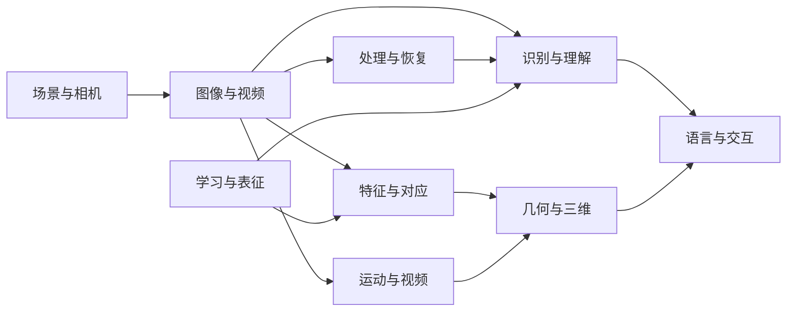

# 计算机视觉知识版图：八条主干怎样连接

> [!abstract] 第一轮认识到什么程度
> 能说出每支的输入、输出、一个关键困难，以及它与其他分支的联系。这里提供学习坐标，不要求背算法目录或先读完全部论文。

**阅读入口：** [[#一、先沿信息流认识问题|看整体]] · [[#二、八条主干与已有入口|找分支]] · [[#三、两条贯穿基础|补先修]]

## 一、先沿信息流认识问题

现实场景经过投影、光照和采样形成图像。之后，方法可能改善图像质量、找对应关系、输出类别与区域、恢复结构与运动，或把视觉结果接到语言和动作。任务可以组合，输出类型却需要分别定义。

图中只画部分关系。生成方向还可以从条件或表示产生图像，不能理解成每个任务都按同一条流水线执行。历史入口见 [[计算机视觉发展史学习笔记]]，学习顺序见 [[计算机视觉-学习路线]]。

## 二、八条主干与已有入口

### 2.1 成像与图像基础

研究场景、光照和相机怎样形成离散图像。先认识投影、颜色、采样、噪声和标定，才能判断后续方法拿到了什么证据。入口为 [[计算机视觉-正向模型与逆问题]]、[[相机标定]]；系统成像概览仍待补。

### 2.2 图像处理与恢复

由观测图像得到更适于观察、分析或更接近目标信号的图像，涉及滤波、去噪、去模糊等。增强视觉效果与恢复真实信息不是同一目标。现有 [[点扩散函数]]、[[混叠]]解释部分基础，尚缺连续的方法概览。

### 2.3 特征、匹配与配准

研究不同图像中哪些位置对应，以及如何估计对齐变换。[[SIFT]]提供局部检测和描述，[[图像配准]]说明对齐任务；匹配之后还要处理异常对应与几何验证，这条完整流程尚待补充。

### 2.4 视觉学习与表征

研究数据、训练目标和结构怎样形成有用表示。先区分结构、监督信号与适配方式，再进入 [[深度学习-部分索引]]、[[基础模型-部分索引]]。现有模型材料较多，训练与验证基础仍需按卡点回补。

### 2.5 识别与场景理解

研究图里有什么、在哪里、属于哪个实例，以及对象之间有什么关系。[[目标检测]]与[[图像分割]]展示不同输出；[[检测两阶段与单阶段的分岔]]解释任务组织。分类、检测材料较多，关键点、关系与文档理解覆盖不足。

### 2.6 几何、深度与三维

从二维观测估计深度、相机与空间结构。[[立体视觉]]、[[运动恢复结构]]、[[束调整]]与[[SLAM]]是入口。先认识投影与对应，再选具体三维表示；本库尚缺完整多视图学习骨架。

### 2.7 运动与视频

研究像素怎样移动、目标身份怎样跨帧维持、事件怎样随时间发生。[[光流]]与[[动作捕捉]]只覆盖其中一部分；目标跟踪、动作与视频理解还未系统整理。相机运动与物体运动要分开分析。

### 2.8 生成、跨模态与交互

研究如何生成视觉内容、连接语言或支持行动。[[模型-GAN]]说明一种生成目标；[[多模态大模型谱系]]说明图文交互；[[视觉伺服]]连接观测与动作。VAE、扩散和具身方向尚缺原文支撑的系统笔记。

## 三、两条贯穿基础

数学工具按问题回补：坐标与矩阵处理几何变换，概率描述不确定性，梯度与优化支持训练及估计。无需先学完全部数学再看视觉。

评价同样贯穿：确定数据来源、划分、输出单位与错误代价，区分图像、目标、像素、事件级指标。不同协议的数字不能组成统一排行榜。

## 四、避免把不同分类轴混在一起

| 分类轴 | 问的是什么 | 例子 |
|---|---|---|
| 任务 | 需要哪种输出 | 目标检测、语义分割 |
| 结构 | 信息怎样计算 | CNN、ViT |
| 学习信号 | 训练约束从哪里来 | 类别标签、自监督、图文配对 |
| 使用方式 | 预训练成果怎样适配 | 线性探测、微调、提示 |
| 应用 | 在什么场景中使用 | 自动驾驶、文档处理 |

同一系统可以同时占据五条轴。例如，使用ViT结构、图文配对信号得到的模型，可以通过文本提示用于图像检索；这些不是五种互斥任务。

## 五、从框架转入深入

先选一个具体问题，再沿所需依赖学习。可以用“特征匹配→几何验证→结构估计”或“共享表示→框预测→区域掩码”这样有因果关系的小链条组织深入，而非同时展开八支。

本人练习与自测进入 [[计算机视觉-学习任务清单]]。上述八支是整理者的学习导航，主要参照Szeliski教材§1.1–§1.3和本库原始论文，不是学科唯一分类；证据范围见 [[论文核读记录]]。
