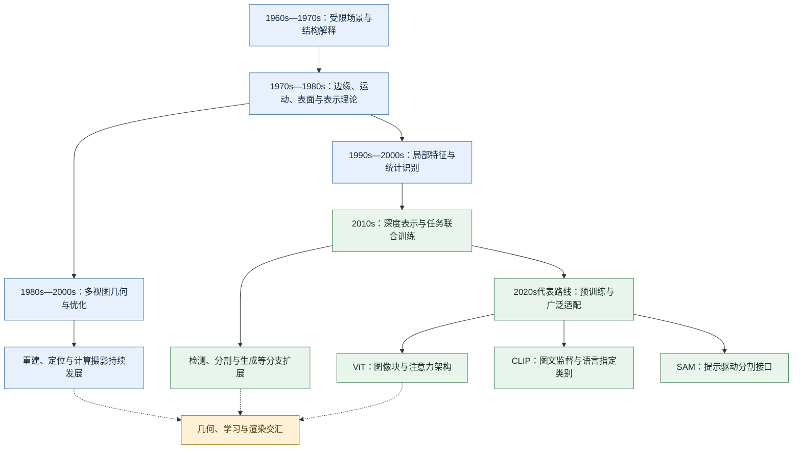
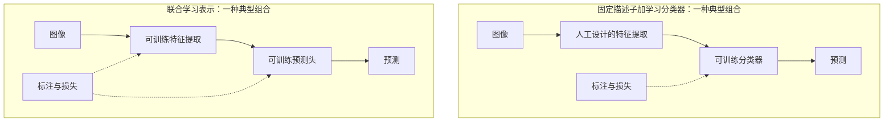
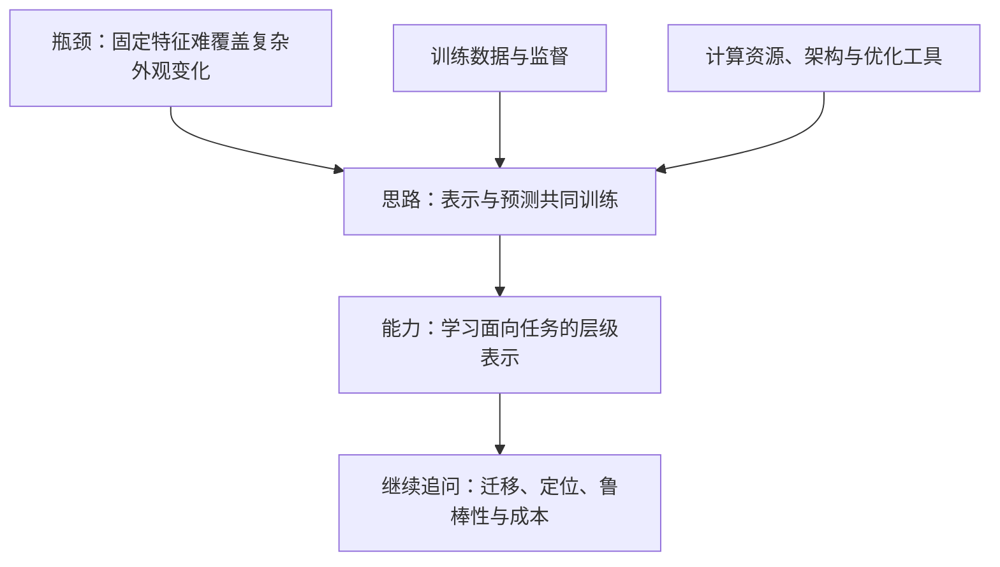
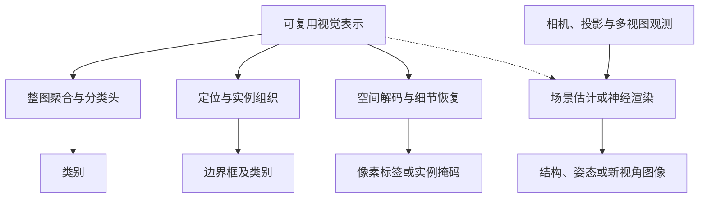
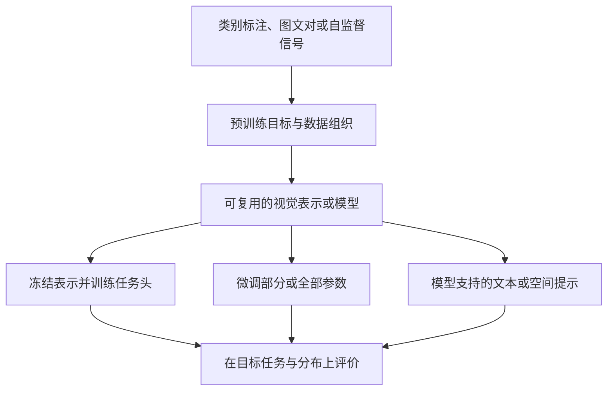

# 计算机视觉发展史：从观测歧义到可复用表示

> [!abstract] 本篇要回答什么
> 计算机视觉的发展，可以沿着“怎样从不充分的图像中获得可靠解释”来理解。研究者不断调整表示、约束、训练信号和计算组织，使系统能处理更复杂的变化、输出更丰富的结果、迁移到更多任务。**几何、统计与学习长期交叉；分类成绩提升不等于整个视觉问题被解决。**

**阅读导航：** [[#二、发展总流程：并行路线怎样交汇|先看发展图]] → [[#四、人工表示与统计学习：先把变化组织起来|理解人工特征]] → [[#五、深度表示的转折：让任务目标参与特征形成|理解深度学习]] → [[#七、预训练与基础模型：复用的范围怎样扩大|理解基础模型]]。各节自测附默认折叠的参考答案；在 Obsidian 阅读视图或实时预览中点击答案标题展开。参考答案是整理者讲解，不代表学生已掌握。

## 一、历史的起点：为什么“看见像素”不等于理解世界

### 1.1 正向成像容易描述，逆向解释未必唯一

先想一张街景照片：行人、建筑和阴影都变成像素。图像中的暗区域可能来自深色衣服，也可能来自遮光；两个大小不同、距离不同的物体，可能具有相似的投影大小。因此，即使完全准确地测到像素，也未必能唯一还原场景。

用教学记号写成：

$$I=F(S,C,L)+\epsilon.$$

$I$ 是观测图像，$S$ 表示场景结构与材质，$C$ 表示相机条件，$L$ 表示照明，$\epsilon$ 是噪声和未建模误差。$F$ 表示从世界到图像的成像过程。这是整理者的简化表达，不是一个囊括全部视觉任务的原文定律。由条件生成图像是正向问题，从图像推测部分条件是逆问题，详见 [[计算机视觉-正向模型与逆问题]]。

历史中许多方法都在处理同一个根本困难：**观测没有提供全部答案，系统必须有依据地缩小解释范围。** 多视图增加观测；几何和物理模型排除不一致的解释；平滑等先验表达偏好；训练数据提供经验规律。这些依据既能互补，也可能在适用条件被破坏时失效。[S1]

### 1.2 先分清三条坐标，才能读懂历史

| 坐标 | 追问什么 | 例子 |
|---|---|---|
| 任务 | 要得到什么输出 | 类别、边界框、掩码、深度、相机姿态、新视角图像 |
| 方法 | 凭什么、怎样得到输出 | 几何约束、手工描述子、统计分类、深度网络 |
| 历史条件 | 为什么某条路线在当时能发展 | 数据采集与标注、计算资源、优化工具、公开评价 |

同一个任务可以跨越多个方法时期；同一种表示也可以迁移到不同任务。研究史因此不能只写成模型排行榜。下文的分期是教学组织，阶段间有重叠，研究活动也从未只剩一条路线。

**自测 1：更高分辨率的单张照片，能保证唯一确定物体的真实大小和距离吗？**

> [!question]- 点击查看参考答案
> 不能保证。分辨率增加了采样细节，却没有自动消除投影中的尺度歧义：较小且较近与较大且较远的物体，仍可能形成相似投影。已知尺寸参照、经过标定的多视图及其他测距信息可能补充约束；各自仍有适用条件。需要区分“测得更细”与“未知量变得可辨识”。

## 二、发展总流程：并行路线怎样交汇

下图压缩了主要联系。**实线表示本图选取的发展或复用路线，虚线表示方法组合；都不表示严格的优先权证明或必然替代。** 年份是定位线索，早期边界取近似范围；代表性论文年份见本节表格。

| 时间定位 | 代表性问题或材料 | 值得理解的变化 |
|---|---|---|
| 1960s—1970s的早期探索 | 受限场景、线条与结构解释 | 用明确假设，把像素组织为可操作的结构 |
| 1970s—1980s的表示探索 | 边缘、运动、表面；Marr 的解释框架 | 区分任务目标、表示算法与实现条件 |
| 1990s—2000s的部分路线 | 多视图几何；SIFT 2004、HOG 2005、DPM 2010代表性论文 | 几何一致性、稳定表示与统计学习形成不同组合 |
| 2012 | AlexNet | 大规模分类中联合学习表示与预测的代表性突破 |
| 2014—2016 | FCN、YOLO、ResNet 的预印本与发表时期 | 密集输出、统一检测与深层优化分别被推进 |
| 2014与2020 | GAN、DDPM代表性论文 | 生成分布成为重要目标；两者是不同路线 |
| 2020—2023 | ViT、CLIP、SAM；NeRF作为另一条交汇路线 | 架构、监督、接口、场景表示分别变化 |

前两行依据 Szeliski 的历史回顾，不主张精确划界。[S1] SIFT、HOG、DPM 的年份指本库已有代表性论文，不表示所有相关思想均始于该年。FCN 的预印本为2014年、会议论文为2015年；YOLO 为2015年预印本、2016年会议论文；ResNet 为2015年预印本、2016年会议论文；ViT 为2020年预印本、2021年会议论文。读年表时要区分首次公开与正式发表。[S2–S7]

> [!note] 图的覆盖范围
> 本篇选择能解释转折的路线，不列完所有方向；视频、光流、计算摄影、机器人视觉等也有各自的发展脉络。2020s部分选取截至2023年的代表性工作解释机制，不是截至2026年的完整前沿盘点。

## 三、早期视觉：从受限世界到中间表示

### 3.1 为什么从简单场景开始

在背景干净、物体形状规则、遮挡有限的场景中，研究者可以尝试由线段、交点和区域关系推断物体结构。这相当于先限制可能世界，再研究视觉推断能否实现。它让问题可以被明确分析，却也把一部分现实难度排除在外。[S1]

把同一路线移到街景中，困难随即出现：纹理会产生大量边缘，阴影边缘不一定对应物体边界，遮挡会使轮廓不完整。**局部图像变化与世界原因之间没有简单的一一对应。** 因而，“先检测边缘，再解释物体”中的后半步，仍然需要场景知识与不确定性处理。

### 3.2 中间表示为什么有价值，又为什么不够

边缘把原始亮度压缩成变化位置；运动线索提供跨时间关系；表面方向和深度描述可见场景的局部结构。这些中间表示让算法可以讨论几何和物体，而不必始终在原始像素上操作。但表示会丢信息，其可靠程度也受噪声、纹理和假设影响。

[[Marr三层次]]提醒我们分别追问：计算目标及其理由是什么，采用什么表示和算法，由什么物理系统实现。它不是“传统、深度、基础模型”三个时代，也不是三层神经网络。[[2.5D草图]]属于表示讨论，与这三种解释层面不同。[S1]

**整理者归纳：** 这段历史留下的方法论，是先说明输出、假设和表示，再讨论算法是否能在真实观测中可靠工作。今天分析一个深度系统时，这些问题仍然成立。

**自测 2：把边缘检测做准确，为什么仍不能直接识别所有物体？**

> [!question]- 点击查看参考答案
> 即使准确找到亮度变化，也不能仅由该变化确定它来自形状、材质还是照明；遮挡还会使物体只呈现部分轮廓。识别需要把局部线索组织成整体解释，并处理视角与外观变化。边缘是证据的一种表示，通常不是物体身份的完整答案。

## 四、人工表示与统计学习：先把变化组织起来

### 4.1 为什么不直接比较两张图的像素

同一建筑换个拍摄角度，像素位置会变化；同一个行人改变姿态，轮廓会变化。若表示对这些变化过于敏感，就难以发现“还是同一个对象”。反过来，若把差异全部抹掉，又可能分不清不同对象。表示设计要在**稳定性与区分性**之间取舍。

[[SIFT]]通过局部位置、尺度和方向组织描述，服务跨图匹配；[[HOG]]汇总局部梯度方向，原论文将其用于行人检测并配合分类器；[[DPM]]把对象组织为部件及其相对位置，用形变代价容纳一定姿态变化。三者分别强调局部对应、外观统计与结构组织，不能画成依次淘汰的关系。原文入口见 [[传统视觉时代-1960s至2011]] 与 [[论文核读记录]]。

### 4.2 “传统视觉”为什么不等于“没有学习”

描述子由人设计，不意味着决策规则也完全由人手写。例如固定 HOG 表示后，可以利用标注样本训练分类器；DPM 的部件模型与判别参数也涉及学习。真正需要问的是：**哪些部分由人规定，哪些参数从数据中得到，哪些模块共同优化？**

实线是推理时的信息流，虚线表示训练信号作用范围，省略了梯度计算的细节。这是两种典型组合的教学对照，不穷尽传统或深度方法；部分深度应用也会冻结特征，仅训练预测头。

### 4.3 几何路线解决另一类可靠性

在多视图重建中，描述子先提供候选对应，但相似纹理可能造成误匹配。[[相机标定]]确定成像关系，几何一致性帮助排除不合理对应，[[运动恢复结构]]联合估计相机和场景，[[束调整]]进一步优化投影误差。它们并不负责用同一种方式识别“猫还是狗”，而是在回答“这些观测能否来自一致的三维解释”。

这也解释了几何为何没有因深度学习而失效：学习可以改进对应关系，但投影约束仍可以检查结果。反过来，缺乏视差、重复纹理、动态物体等条件，也会让几何系统遇到困难。方法有数学表达，不等于任意输入都能可靠求解。[S1]

**自测 3：HOG加分类器与深度分类网络的关键区别是什么？学习特征与几何优化能组合吗？**

> [!question]- 点击查看参考答案
> 前者的典型设置固定描述方式，主要从数据学习分类决策；后者可让任务损失同时调整特征提取与预测参数。区别在训练范围和表示形成方式，不能简单说成“一个学习、一个不学习”。学习特征可提供候选匹配，几何检验和束调整可约束这些匹配的空间一致性；前者与后者承担不同职责，可以组合。

## 五、深度表示的转折：让任务目标参与特征形成

### 5.1 AlexNet的重要性应怎样表述

AlexNet（2012）是大规模图像分类中深度卷积网络取得突破的代表性工作，不是神经网络或卷积网络的起点。论文把多层特征学习、分类目标、GPU训练和抑制过拟合的措施组织为可训练系统。[S2]

与固定描述子相比，分类误差可以沿网络反向传播，使前面的表示随任务一起变化。人仍然决定网络结构、训练目标、数据处理与优化方案；“自动学习特征”并不意味着设计工作消失。

> [!note] 整理者的因果解释
> 规模化成功需要多种条件配合：数据提供可学习的变化，计算资源支持反复训练，架构约束可学习函数的形式，优化与正则化使训练可行。某个比赛结果能够证明特定条件下的有效性，却不能单独证明其中哪项因素解释了全部进步。

这张因果图是整理者的机制归纳，不是对所有历史因素的定量归因。

### 5.2 更深不等于自动更好：ResNet说明什么

增加深度扩大了表示设计空间，也可能使优化更困难。ResNet 将若干层学习的映射写成残差形式 $y=x+F(x)$：$x$ 沿捷径传递，分支学习相对输入的修正；维度不一致时需适当映射。其历史意义之一，是改变了深网络的优化组织。[S3]

因此，不能把所有网络发展都概括为“层数越来越多”。深度、信息路径、计算分配、训练稳定性与效率，是不同设计问题。也不能认为残差连接保证任何网络、任何数据都更好。

### 5.3 从数据学习规律，也会学到偏差

假设训练集里的牛常出现在草地上，系统可能利用背景来预测类别。这样的相关性在同分布测试中有帮助，换到雪地却可能失效。这是教学例子，说明优化目标奖励的是训练数据中的有效线索，不保证线索一定对应我们希望的因果关系。

更大训练集可能改善覆盖，也可能保留偏差。要判断系统进步，需要看测试分布、数据划分和评价目标，而不能只看参数量。

**自测 4：端到端训练是不是不需要先验？训练误差低是否说明真正理解了对象？**

> [!question]- 点击查看参考答案
> 两者都不能这样推断。卷积、注意力、数据增强和损失设计都带有建模选择；端到端主要描述某个训练链路可以联合优化。低训练误差只说明模型能拟合训练目标，可能依赖背景、数据泄漏或记忆。需要独立测试、分布变化与符合任务目的的检查，才能判断泛化范围。

## 六、从类别到空间、生成与三维：输出改变后，还缺什么

### 6.1 分类网络不能原样回答所有问题

分类只需给出整图类别；检测还需定位多个实例；语义分割需为像素分配类别；实例分割还要区分同类的不同个体。把分类网络末端的输出数量改大，并不会自动解决位置对应、尺度和实例分离。

FCN 把分类网络改造为密集预测网络，结合深层语义与较浅层细节；YOLO 将检测组织为由整图直接预测边界框及类别的统一网络。[S4][S5] 它们说明可复用特征仍需与输出结构匹配。二阶段与单阶段的进一步解释见 [[检测两阶段与单阶段的分岔]]。

图是任务关系示意，不表示每个系统都必须共享同一个编码器；生成模型也不一定从分类特征出发。

### 6.2 生成路线改变了学习目标

识别主要从图像推断标签等属性；图像生成则需要建立能够产生样本的模型。GAN（2014）通过生成器与判别器的对抗训练学习数据分布；DDPM（2020）是扩散生成路线的代表，学习逐步去噪的反向过程。[S9][S10] 这不是“分类器越来越强自然变成画图工具”，而是学习目标与采样过程发生了变化。

生成质量、条件遵循与事实一致性也需要不同评价。一张图看起来真实，不保证其中的物理关系、文字或空间结构正确。GAN、扩散及其他生成路线也不是在某个年份完成整齐交接。

### 6.3 NeRF：学习与物理结构怎样结合

NeRF（2020）把场景表示为连续的神经辐射场：网络根据空间位置和观察方向给出密度与颜色信息，再沿相机射线进行体渲染，用渲染图像与观测图像的差异优化场景表示。原始方法使用已知相机姿态的多视图。[S11]

它说明神经网络可以进入成像与优化链路；目标是新视角合成，不能直接等同于“恢复了唯一正确的实体几何”。还要区分针对一个场景优化的神经表示，与跨大量数据预训练后适配的通用模型。

**自测 5：分类正确、掩码准确、新视角逼真，能否互相替代作为“理解场景”的证据？**

> [!question]- 点击查看参考答案
> 不能直接替代。类别正确可能没有准确定位；掩码准确不必知道物体深度；新视角逼真也不保证得到唯一真实的几何。它们分别约束不同输出。要先明确希望系统理解什么，再选择对应的评价与失效测试。

## 七、预训练与基础模型：复用的范围怎样扩大

### 7.1 先预训练再迁移，并非2020年后才出现

在深度视觉阶段，分类预训练后迁移到检测、分割已经很重要，FCN 就复用了分类网络的表示。[S4] 后续变化在于训练数据与信号更丰富、复用目标更广、适配接口更多，而不是某一年突然发明“先学再用”。

这些方式并非每个模型都支持。提示在输入端指定需求，微调会改变参数；两者可以组合，但不能混用名称。进一步见 [[预训练-适配范式]]。

### 7.2 ViT、CLIP、SAM分别改变哪一层

| 代表工作 | 主要变化 | 具体机制与边界 |
|---|---|---|
| ViT：2020预印本、2021会议论文 | 架构与表示组织 | 图像切块成为 token，借助 Transformer 交互；原文重点是规模化预训练后的分类迁移，并非天然适合所有小数据任务 |
| CLIP：2021 | 监督来源与类别指定方式 | 以匹配图文对组织对比学习，利用图像与文本表示的相似度实现零样本分类；原始模型不是对话式语言生成器 |
| SAM：2023 | 分割任务与提示接口 | 利用点、框等提示指定分割需求，输出掩码；提示式分割能力不等于任意语义理解或对话能力 |

这些事实分别见原论文摘要及机制部分。[S6][S8] 本库深入入口为 [[模型-ViT]]、[[模型-CLIP]]、[[模型-SAM]]。三者处于不同设计坐标，不能画成 ViT → CLIP → SAM 的升级链。

### 7.3 自监督为什么能减少人工类别标签依赖

自监督把训练目标从数据结构中构造出来，例如让同一图像的不同增强视图在表示中对应，或由可见部分预测被遮挡的信息。学习信号并没有消失，而是来源改变。不同方法鼓励的性质不同，也依赖增强方式、预测目标和数据分布。分类机制见 [[综述-Uelwer-自监督表征学习]]。

图文对也提供了监督，只是它通常不是人工为每张图选择的固定类别标签。因此，“没有类别标注”“没有人工整理数据”“完全没有监督”不是同一件事。

### 7.4 通用性必须拆开检查

一个模型能适配多类任务，未必能适应医学影像等不同分布；能接受文本，也未必能执行复杂空间推理。应分别检查任务覆盖、分布覆盖、输入输出接口和适配成本。[[通用性的三种含义]]提供进一步辨析；[[综述-Ghosh-视觉语言模型]]补充跨模态形式。

**自测 6：CLIP用新类别的文字说明完成分类，与重新训练分类器有何区别？SAM的“提示”一定是文字吗？**

> [!question]- 点击查看参考答案
> CLIP零样本分类可把候选类别写成文本，经文本编码器形成表示，再与图像表示比较，不必为这组类别重新训练一个有监督分类头。但结果依赖类别表述、训练覆盖与测试分布，“零样本”不等于从未见过相关概念。原始SAM的常用提示包括点和框等空间信息；本篇讨论的接口不能被理解成任意自然语言指令。提示是一种输入角色，不专指文本。

## 八、从历史提炼判断方法的尺度

### 8.1 改进发生在哪个环节

**整理者归纳：** 分析新方法时，可以依次问下面几个问题。它们是阅读工具，不是历史发展的必然定律。

| 检查点 | 需要说清楚什么 | 典型误判 |
|---|---|---|
| 观测 | 是否增加视角、时间或其他传感信息 | 把更多参数当成更多观测 |
| 表示 | 哪些差异被保留，哪些变化被弱化 | 把特征维度增加等同于语义增强 |
| 约束与训练目标 | 物理一致性或统计信号怎样进入系统 | 把自监督当成没有训练目标 |
| 优化与计算 | 新表示能否被有效学习和运行 | 只看架构名称，不看训练设置 |
| 适配与评价 | 在什么任务、分布和成本下有效 | 把单榜单改善推广到所有视觉能力 |

### 8.2 为什么历史不是“越来越少先验”

手工描述子把偏好写在运算中；卷积把局部性等偏好写进结构；数据增强规定哪些变化应当不影响预测；大规模预训练从数据中获得经验偏好。先验和设计选择的形式、来源、强弱发生了改变，它们没有简单消失。

同样，能拟合训练样本不等于获得可解释的物理模型；具有几何约束也不等于拥有完整语义。方法的价值取决于任务与条件，发展史应帮助我们选择组合，而不是按年代判定先进与落后。

### 8.3 进步应该怎样评价

分类、检测、分割、重建、生成的评价目标不同，不能把准确率、平均精度、交并比或渲染质量直接排成一条总分。即使指标同名，也要核对数据集、划分、协议、模型版本及训练资源；速度还受硬件、分辨率、批量和预处理影响。

本篇不罗列性能数字，避免跨设置比较造成的错误直觉。深入实验时回到原文表格与协议，并区分分布内表现、分布变化和实际使用成本。

**自测 7：某个新模型的分类准确率更高，能否据此判断它更适合机器人定位？**

> [!question]- 点击查看参考答案
> 不能。分类需要区分类别，定位则要可靠估计姿态并处理空间对应、动态干扰与连续运行。两者可能复用表示，但需要检查定位误差、轨迹可靠性、延迟和具体环境。分类成绩是局部证据，不能替代目标任务评价。

## 九、综合自测：能否用自己的话解释发展逻辑

建议先闭合答案，围绕一张街景照片口头作答，再展开核对理由与条件。这里不预填个人学习记录。

**题 8：给“传统方法 → 深度学习 → 基础模型”这条粗略时间线，补出真正发生变化的内容。**

> [!question]- 点击查看参考答案
> 可以从三个尺度回答：固定描述与学习决策的组合，扩展为表示和预测共同学习；任务能力又依赖定位、密集输出、渲染等专门设计；预训练进一步扩大监督来源与复用范围，形成不同适配接口。但三者不是互斥集合：传统系统可以学习，深度系统也可冻结特征，基础模型仍需结构与目标设计。几何与物理约束一直可以参与系统。

**题 9：设计一个“学习＋几何”的街景重建流程，并指出两个失败条件。**

> [!question]- 点击查看参考答案
> 一种合理流程是：多张图像 → 学习特征与候选匹配 → 几何一致性检验 → 估计相机姿态和三维点 → 束调整；需要时再加入稠密重建或渲染。重复纹理可能导致错误对应，视差不足可能使深度估计不稳定；动态物体会破坏静态场景假设。答案重点是说明各模块职责和条件，而非认为加入深度模型即可消除所有误差。

**题 10：解释“从图像识别到基础模型”的变化，为什么不能只谈模型规模？**

> [!question]- 点击查看参考答案
> 规模之外，还应说明输入输出、监督来源、表示组织及适配方式。例如ViT改变图像的架构处理，CLIP利用图文关系形成可按文本指定类别的表示，SAM把分割组织为可提示任务。规模只有与数据、目标、优化和计算条件一起讨论才有意义；参数更多也不保证分布外可靠性、空间理解或低部署成本。

回到 [[计算机视觉-知识版图]] 选择要深入的任务，按 [[计算机视觉-学习路线]] 补先修。阶段展开见 [[传统视觉时代-1960s至2011]]、[[深度学习革命-2012至2019]]、[[视觉基础模型时代-2020至今]]。[[综述-视觉智能发展四阶段]]可作为另一种作者分期对读，不必强行统一阶段数量。

## 十、来源与核查边界

正文的分期、跨材料联系、教学例子和流程图由整理者综合，不属于某一篇论文的原话。来源支持具体机制与历史入口，不代表本篇完成了优先权考证或整个领域的穷尽式综述。

| 标号 | 来源与定位 | 本篇使用范围 |
|---|---|---|
| S1 | [[精读-Szeliski-第1章-绪论与发展史]]；本地2010第一版草稿§1.1–§1.3；[作者教材入口](https://szeliski.org/Book/) | 早期研究、逆问题与表示框架沿用本库已有核读；本次未重新全文核读教材；不混用不同版页码 |
| S2 | [Krizhevsky等，AlexNet，2012](https://www.cs.cmu.edu/~jeanoh/16-785/papers/krizhevsky-nips2012-alexnet.pdf)，摘要、§3–§4 | 分类系统、可训练表示与训练条件 |
| S3 | [He等，ResNet，2015预印本](https://arxiv.org/abs/1512.03385)，摘要；残差结构见§3、图2 | 深层优化与残差表达 |
| S4 | [Long等，FCN，2014预印本／CVPR 2015](https://arxiv.org/abs/1411.4038)，摘要；网络改造见§3–§4 | 分类表示迁移与密集输出 |
| S5 | [Redmon等，YOLO，2015预印本／CVPR 2016](https://arxiv.org/abs/1506.02640)，摘要、§2 | 统一检测的问题组织 |
| S6 | [Dosovitskiy等，ViT，2020预印本／ICLR 2021](https://arxiv.org/abs/2010.11929)，摘要、§3、图1；[[模型-ViT]] | 架构变化与预训练迁移 |
| S7 | [[论文核读记录]]；SIFT 2004、HOG 2005、DPM 2010代表性原文及对应术语卡 | 沿用已有核读支持人工表示与统计学习的分工；本次未重读三篇全文 |
| S8 | [Radford等，CLIP，2021](https://arxiv.org/abs/2103.00020)；[Kirillov等，SAM，2023](https://arxiv.org/abs/2304.02643)，各自摘要及§3；本库对应模型档案 | 图文监督、零样本分类与可提示分割的区别 |
| S9 | [Goodfellow等，GAN，2014](https://arxiv.org/abs/1406.2661)，摘要 | 对抗生成的基本目标 |
| S10 | [Ho等，DDPM，2020](https://arxiv.org/abs/2006.11239)，摘要、§2 | 扩散与去噪路线的定位 |
| S11 | [Mildenhall等，NeRF，2020](https://arxiv.org/abs/2003.08934)，摘要、§3–§4 | 场景表示、体渲染及已知姿态条件 |

**本次核查深度：** 联网核对上述可访问论文的摘要、年份与机制概述；具体结构同时参照本库已有档案与精读，正文提供深入定位供继续阅读，不声称逐页复核了所有原文。未引用跨实验性能数字，未更新个人掌握状态。自监督分类主要沿用本库综述；本篇不是最新方法清单。
