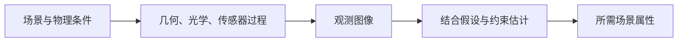

# 正向模型与逆问题：从“图像怎样形成”理解“怎样反推场景”

> [!abstract] 核心认识
> 成像把场景及相机条件变成图像，视觉则根据观测推断所需属性。生成方向相同不代表反推唯一；明确未知量、约束和评价目标，比先选择算法名称更重要。

## 一、从一块暗区域开始

图像中一个暗斑，可能对应深色材料、阴影、表面朝向或曝光变化。观察只给出结果，没有直接告诉我们哪一种原因成立。这就是视觉反推困难的一种具体表现。

## 二、用正向关系描述问题

用教学记号写作：

$$
I=f(S;\theta)+\epsilon.
$$

$I$ 为观测，$S$ 为待描述场景，$\theta$ 为相机、照明等参数，$\epsilon$ 为噪声或简化误差。函数 $f$ 的具体形式依问题选择：几何模型解释位置关系，光度模型解释强度，传感器模型解释采样和响应。

反向箭头不是把 $f$ 自动求逆。它可能只估计深度、位姿或一个标签，也可能需要额外视图和先验。

## 三、为什么需要约束

若多个场景都能产生相同观测，仅降低图像重建误差还不能区分它们。例如简化光度模型中反射与照明相乘，放大一个再缩小另一个仍可能产生相同图像。

可增加观测、固定部分条件，或用平滑性、形状与统计先验减少歧义。常见教学优化形式为：

$$
\hat S=\arg\min_S D(f(S),I)+\lambda R(S).
$$

$D$ 衡量模型与观测的一致程度，$R$ 表达对解的偏好，$\lambda$ 调整权衡。它是说明数据项与先验的概括形式，不代表所有视觉算法都必须显式使用这个损失。

## 四、与数据驱动方法的关系

神经网络可直接学习从图像到输出的映射，但仍受结构、训练目标和数据分布约束。不能把“端到端”写成没有先验，也不能把显式成像模型当成所有任务的唯一途径。

自测：什么情况下两组不同参数得到相同图像？加入一条先验后，是否就保证估计是真实场景？本人回答另记。

**来源与核查范围：** [[Szeliski-Computer-Vision-Algorithms-and-Applications-1st-draft-2010.pdf]] 第 1.1、2.2 节相关成像与逆问题讨论。式中记号与优化形式为整理者教学概括；正式正则化例子需结合书第 3.7 节，不能把本篇当具体算法推导。定义回查见 [[正向模型]]、[[逆问题]]、[[正则化]]。
