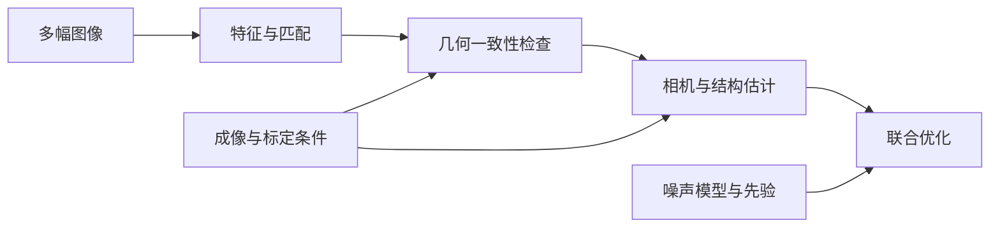

# 传统视觉总览：用表示与约束连接图像和世界

> [!abstract] 框架认识
> 这一分区主要认识成像、局部特征、几何和优化怎样解决视觉问题。它们各自处理不同约束，也能与学习方法组合；2011是资料分区的时间界线，不是这些方法的失效日期。

**阅读入口：** [[#一、先看要解决什么|问题]] · [[#二、四组主要思想|方法]] · [[#三、方法怎样连起来|关系]] · [[#五、深入入口与自测|继续学习]]

## 一、先看要解决什么

两张建筑照片可以用来拼接全景，也可以用来估计相机和建筑结构；一张行人照片则可用于检测人在哪里。输入都含像素，但未知量与约束不同。

本分区不是要求先学完1960s至2011的全部历史，而是为这些任务建立可解释的基础。当前材料以Szeliski教材第1章及SIFT、HOG、DPM原文为主，几何与优化术语只提供局部入口，尚不等于系统覆盖整章内容。

## 二、四组主要思想

### 2.1 成像：先知道观测从哪里来

图像亮暗既与表面有关，也与照明、相机和采样有关。[[计算机视觉-正向模型与逆问题]]解释为什么由结果反推原因会有歧义。[[BRDF]]、[[点扩散函数]]和[[混叠]]分别帮助定位反射、模糊与采样造成的影响，不宜都概括成“图像不清晰”。

### 2.2 特征：把像素变成更适合比较的表示

[[SIFT]]为局部区域确定位置、尺度和方向后计算描述子，服务跨图匹配；[[HOG]]汇总局部梯度，典型用法是配合滑窗分类；[[DPM]]进一步让整体和部件共同评分，并允许受惩罚的位置变化。

它们并非三代通用替代品。一个侧重对应关系，一个描述窗口外观，一个组织目标结构；任务与输出不同，不能只排成精度排行榜。

### 2.3 几何：由对应关系约束相机与结构

[[相机标定]]帮助建立图像与空间射线的关系；[[立体视觉]]利用不同视点增加深度约束；[[运动恢复结构]]从多图估计相机和场景；[[束调整]]联合细化相机参数与三维点。

这里最容易漏掉的是中间条件：对应点需要可靠，视点变化要提供足够信息，退化配置可能使估计困难。几何公式不能替错误匹配自动兜底。

### 2.4 优化：在多种解释中作有根据的选择

当观测不足或含噪时，方法常同时考虑数据一致性与先验偏好。[[正则化]]解释为什么加入约束，[[马尔可夫随机场]]组织变量依赖，[[图割]]则在特定能量条件下提供优化工具。

这三者分别是建模原则、概率结构与求解方法，不能当作同层的三个互斥模型。局部适用条件应进入深入笔记，不在总览铺开全部推导。

## 三、方法怎样连起来

这是整理者给出的典型重建关系图，不是所有视觉任务的固定流水线。[[图像配准]]可能只需要图像间变换，不要求完整三维结构；目标检测可用另一条判别路线。图中每条箭头代表信息与条件的依赖，不代表年代先后。

## 四、关键变化与其他方向

增加视点、引入稳定局部表示、把问题写成可优化目标，会改变能处理的场景与不确定性。这些变化可以同时发生，不能归结为“规则→统计→学习”的必然接班。

后来的深度方法让更多表示从数据学习，但仍面对成像噪声、投影歧义和评价定义。例如学习描述子可以接入几何重建，学习分割结果可以帮助定位目标区域。先明确要替换哪一环，才能比较作用。

[[Marr三层次]]提供另一种检查：任务为何成立、表示与算法如何工作、物理资源怎样支持。它与历史分期是两个视角。

## 五、深入入口与自测

| 当前疑问 | 下一篇 |
|---|---|
| 为什么同一亮度有不同物理解释 | [[计算机视觉-正向模型与逆问题]] |
| 两张图为何能重新找到同一局部 | [[SIFT]]、[[尺度空间]] |
| 部件移动为何还可被识别 | [[HOG]]、[[DPM]] |
| 该选什么教材章节 | [[精读-Szeliski-第1章-绪论与发展史]] |

自测：拼接、检测与三维重建分别要什么输出？为什么特征匹配之后仍需几何检查？哪些条件能减少单图歧义？学生自答留待填写。

**证据入口：** Szeliski第1章及局部成像/几何/优化段落；Lowe2004、Dalal与Triggs2005、Felzenszwalb2010原文，具体位置见相应笔记及 [[论文核读记录]]。全领域缺口见 [[计算机视觉-知识版图]]。
