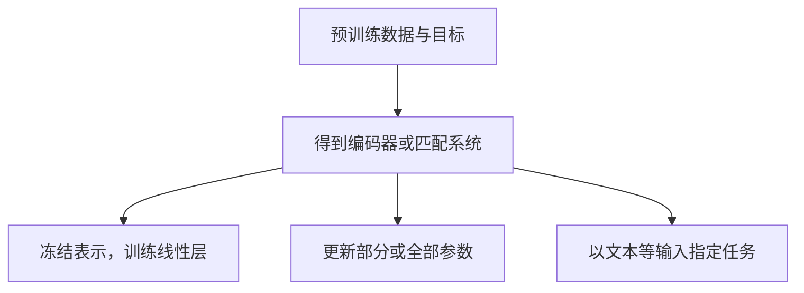

---

title: 预训练-适配范式

type: 概念

topic: 计算机视觉/基础模型

tags: [计算机视觉/基础模型, 主题/范式]

status: 精进中

created: 2026-11-17

updated: 2026-11-17

source: "ViT / CLIP / SAM 原文与 Uelwer 自监督综述（见各精读笔记）；整理者综合（非学生自答）"

variant: 方法综合
---

# 预训练与适配：先学表示，再明确下游怎样使用

> [!abstract] 核心认识
> 预训练与适配描述学习阶段，而不是某一种网络结构。迁移时需要说明哪些信息来自预训练、哪些来自目标任务，以及哪些参数实际更新。

## 一、从一个具体问题开始

已有一个图像编码器，现在要识别新的类别。可以从随机参数开始训练，也可以从已有参数出发；即使选择后者，仍有“冻结表示”“更新编码器”“只改变文本候选”等不同使用方式。

因此不能只写“用了预训练模型”，还需交代适配接口和目标监督。

## 二、把不同阶段放在同一张路径图中

线性层分支对应一种有标签适配；参数更新分支涵盖多种微调；文本分支以 CLIP 的零样本分类为例，不表示任意预训练系统都有该接口。

## 三、原理：哪些知识被复用，哪些仍要学习

预训练使参数或表示已对某种数据和目标作过调整，下游希望这些结构能帮助目标任务。新类别的分类层未必可以直接沿用：ViT 第 3.2 节替换分类头，再进行下游训练。

MAE 的预训练解码器承担重建任务，下游识别主要使用编码器；因此“复用模型”不一定保留每个训练模块。CLIP 则把类别描述编码为分类向量，没有在目标标签上训练分类头，属于另一种使用协议。

> [!example] 教学辨析
> 都使用同一视觉编码器：方案 A 冻结它并训练猫狗分类层；方案 B 连同编码器一起更新；方案 C 用 CLIP 的猫狗文本向量直接匹配。三者使用的目标标签和参数更新不同，结果不能统称为同一种迁移精度。

## 四、适用条件与边界

迁移收益受源数据、目标分布、输出任务、适配资源和评价协议影响。预训练不保证目标任务有效，也不自动解决域偏移；冻结更省更新成本，不等于最终能力一定相同。

自测：只更换提示文本是否发生参数微调？重建预训练中的解码器为何未必进入分类推理？本人回答另记。

**依据与范围：** [[Dosovitskiy2020-An-Image-is-Worth-16x16-Words-Transformers-for-Image-Recognition-at-Scale.pdf]] 第 3.2 节；[[He2021-Masked-Autoencoders-Are-Scalable-Vision-Learners.pdf]] 第 3–4 节；[[Radford2021-Learning-Transferable-Visual-Models-from-Natural-Language-Supervision.pdf]] 第 3.1 节。本篇为整理者的跨材料综合，非学生个人学习记录。
