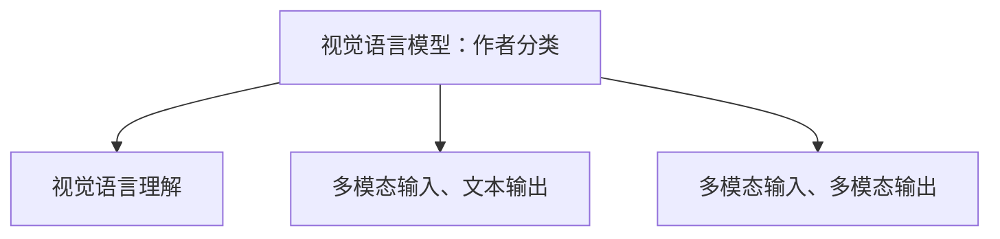

# Ghosh 等视觉语言模型综述：先看输入输出，再看交互机制

> [!abstract] 综述主线
> 作者按视觉语言理解、多模态输入生成文本、多模态输入生成多模态输出组织材料。分类帮助定位接口，但同一类别仍可能包含不同结构，能力与可靠性需要另查证据。

> [!important] 版本先说明
> 本地文件名含 2024，首页实际为 arXiv:2404.07214v4，日期 2025-10-14。本篇依据这份本地修订版，不将其中模型覆盖范围当成 2024 年初版本的事实。

## 一、领域问题与主要难点

视觉与语言要在表示、对应关系和输出目标上连接。图文匹配、看图回答和生成多种模态不是同一任务；困难既包括如何连接表示，也包括数据、训练与评价是否对应目标。

综述列出多类系统，不意味着它们都用一个统一“图像编码器加语言模型”结构。比如原始 CLIP 的输出是匹配分数，不直接逐词生成答案。

## 二、作者怎样分类

第 2 节及图 1 以功能和模态接口分组；它不是按参数更新方式、注意力结构或统一训练目标划出的互斥机制分类。作者使用的“更先进”等叙述也不等于有统一实验支持所有任务的能力排序。

## 三、不同路线怎样工作

### 3.1 对齐与匹配

双编码器分别编码图像与文本，用共同空间比较相似度。CLIP 具体机制已由 [[论文-Radford-CLIP]] 回原文核对。匹配接口适合用来理解检索或文本指定分类，不应直接称为生成式对话。

### 3.2 连接视觉表示与文本生成

图 2 列出 Q-Former、Perceiver Resampler、MLP 等连接方式。核心问题是怎样把视觉信息提供给生成模型，以及哪些参数冻结、哪些参与训练。

此处是对综述组织的概括，不认证各连接器的全部原始算法。BLIP-2、LLaVA 等具体模型若要精确实现，仍需其各自原文，不能仅凭图 2 复现。

### 3.3 多模态输出

系统若还生成图像、音频或其他输出，需要相应表示、解码与训练目标。“输入可以有多种模态”和“输出也可以有多种模态”是两个条件。

## 四、怎样比较与理解局限

> [!example] 教学辨析
> 一个模型能从候选文字中选出“狗”，另一个能生成关于图像的一段回答。二者输出不同，不能只用一个“理解强弱”词替代任务和评价说明。

综述汇总多种基准与名录，当前笔记未统一复测。不同模型版本、训练数据及评分规则下的数字不能直接排名。流畅文本、匹配高分或模态数量更多，也都不能单独证明事实可靠。

## 五、自测与来源

自测：为何输入输出分类不能替代机制分类？连接器与完整视觉编码器的作用如何区分？CLIP 的分数为何不是一段回答？本人回答另记。

**来源与核查范围：** [[Ghosh2024-Exploring-the-Frontier-of-Vision-Language-Models-Survey.pdf]] 本地 v4，第 1–2 节、图 1/2、BLIP-2 相关条目，PDF 第 1–5 页定向核对。其具体模型介绍在本篇按综述转述处理，未逐篇读取全部原始引用，未重核榜单。
