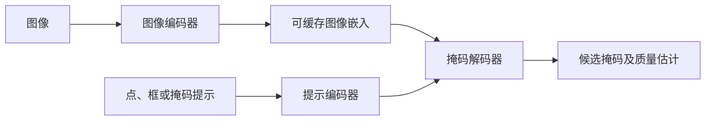

# SAM：把分割组织为可反复提示的接口

> [!abstract] 核心认识
> SAM 将较昂贵的图像编码与轻量提示解码分开，输入图像及提示后输出区域掩码。它处理提示可能对应多个合法区域的歧义，输出掩码不等于给出语义类别或专业判断。

## 一、研究问题与提示式任务

一个点可能指向物体整体，也可能指向部件。若要求所有提示都只有唯一掩码，就会忽略交互分割的歧义。论文将任务设计为：给定提示，产生合理掩码，并研究其向新数据与任务的迁移。

提示是推理输入，不等于下游训练标签；但模型训练本身仍需要掩码等监督，不能因此称为从未使用标注。

## 二、编码一次图像，再反复解码

图像编码器采用经过相应预训练和改造的 ViT，生成图像嵌入；提示编码器将几何提示或已有掩码变成可与图像信息组合的表示；解码器根据两者产生前景概率与质量估计。

**缓存后的解码时间与整张新图的编码时间必须分开。** 原文第 3 节约 50 ms 的浏览器 CPU 说明以图像嵌入已计算为前提，不是任意设备上处理新图的完整耗时。

## 三、怎样处理一个提示的多种解释

作者让模型对一个提示输出多个候选掩码，并为其估计质量。在有歧义的情况下，这能保留整体、部分等不同解释，而非只把多个合法答案平均。

训练时对候选采用最小掩码损失的反向传播方式，并训练质量估计；“候选中最接近真值的掩码”与推理时按模型分数选中的掩码不同，评价时要说明是否使用 oracle 选择。

> [!example] 教学情形
> 在一辆车的轮子上点一下，可能希望分割轮子，也可能希望分割整车。候选多样性处理的是提示含义不唯一，而不是证明模型知道使用者的真实意图。

## 四、模型与数据引擎怎样相互作用

数据引擎依次经历辅助人工、半自动和自动阶段，利用改进模型帮助收集更多掩码，再用数据改进模型。第 5 节报告 SA-1B 的图像与掩码规模，并解释其自动掩码的来源和质量分析。

因此“大规模自动标注”不等于整个过程从未借助人工；数据数量也不能代替对任务语义、分布和质量的检查。

## 五、文本提示、实验与能力边界

第 3 节在总体架构中讨论文本嵌入，但第 7.5 节 text-to-mask 是**修改训练程序后的概念验证**。不能把该探索直接写成所有默认 SAM 实例都具有可直接使用的文本分割能力。

第 7.6 节在特定点提示协议下比较数据阶段和规模，区分最高评分掩码与相对于真值选择的最佳掩码。候选中存在好结果不等于系统会自动选对。

掩码是空间输出，不自动包含医学诊断、开放词汇分类或目标重要性判断。专业领域仍需独立验证。

## 六、自测与来源

- 缓存什么信息，才可能让多次提示更便宜？
- 多候选和质量估计各自解决什么问题？
- 为什么不能把 text-to-mask 实验等同默认接口？

本人回答另记。结构速查见 [[模型-SAM]]，概念见 [[提示分割]]。

**来源与范围：** [[Kirillov2023-Segment-Anything.pdf]] 第 3–5、7.5–7.6 节、图 4，PDF 第 5–6、11 页定向查阅。未完整重核全部 23 个数据集结果或训练附录，不认证专业领域性能，未复现交互程序。
