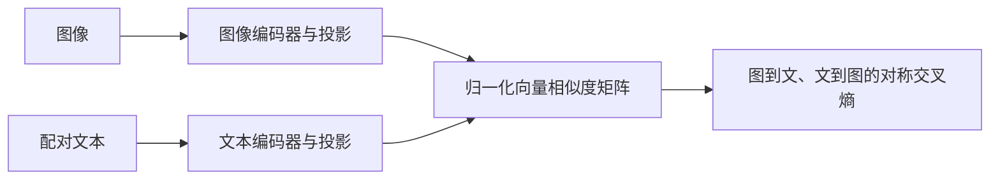

# CLIP：用图文配对学习可由文本指定的分类接口

> [!abstract] 核心认识
> CLIP 训练图像与文本编码器，在批量内区分匹配图文对。推理时可将候选类别描述编码为文本向量，与图像比较完成零样本分类。它不是直接生成回答的视觉语言对话模型。

## 一、研究问题：监督为何必须是固定类别表

标准分类训练把图像映射到固定标签；网上已有图像常伴随描述文本。论文尝试利用这些配对文本学习视觉表示，并使表示与语言联系，从而支持无需在目标数据集训练分类头的迁移。

“自然语言监督”不等于完全没有人工信息：文本由人或既有系统产生，采集和筛选也会改变数据分布。论文第 2.1 节专门讨论了这类方法在监督术语上的差异。

## 二、双编码器怎样建立可比较空间

图像与文本先各自编码，再线性投影到共同维度，并作 L2 归一化。向量可比较并不表示两种输入的每个局部元素都已经对齐；训练主要使用整对样本的对应关系。

## 三、从配对关系到训练目标

### 3.1 为什么构造相似度矩阵

一个批量有 $N$ 个配对样本，图像 $i$ 与文本 $i$ 是观测到的配对。计算所有 $N^2$ 个图文组合的分数 $s_{ij}=\alpha u_i^Tv_j$，其中 $u_i,v_j$ 为归一化嵌入，$\alpha$ 为可学习的 logit 缩放。

图到文方向的损失可写为：

$$
L_{I\to T}=-\frac1N\sum_i\log\frac{\exp(s_{ii})}{\sum_j\exp(s_{ij})}.
$$

分子是正确配对，分母使该文本与批量内其他文本竞争；交换方向得到文到图损失，再取平均。这是对原文图 3 伪代码的公式化说明。

> [!example] 教学情形
> 三张图分别配“猫”“船”“树”的描述，矩阵中希望对应配对分数较高。但两个不同样本可能语义相似，未配对不自动表示语义上绝对相反；这是批量构造与语义关系需要区分的地方。

### 3.2 编码器不是对话解码器

图像编码器可采用原文研究的 ResNet 或 ViT，文本编码器产生整体文本表示。模型通过相似度作匹配，不通过自回归解码器逐词生成答案。

## 四、零样本分类怎样运行

为候选类别写描述，经文本编码器得到向量；图像得到视觉向量，计算相似度并选择类别。文本向量可预先计算并缓存，因此分类集合可以由文本指定。

“零样本”在这里指无需用目标数据集的有标签训练样本拟合该分类接口，不表示预训练完全没有见过有关概念，也不保证与测试图像无任何数据重叠。提示写法和候选集合会影响结果。

## 五、实验证据与迁移边界

第 3.1 节评价零样本迁移，其他评价如冻结视觉表示后的线性探测属于不同协议。必须分清“文本生成类别向量”和“用目标标签训练线性层”。

第 2.2 节报告采集四亿图文对；这是数据构建口径，不能直接与四亿精细类别或像素标注画等号。本文还需要讨论数据覆盖、重叠与偏差，不能据其零样本结果推断对任意新领域可靠。

## 六、自测与来源

- 对称损失的两个方向分别在比较什么？
- 为什么零样本分类仍要提供候选类别描述？
- 为什么图文匹配不能直接当作生成式问答？

本人回答另行填写。速查见 [[模型-CLIP]]，协议辨析见 [[零样本迁移]]、[[线性探测]]。

**来源与范围：** [[Radford2021-Learning-Transferable-Visual-Models-from-Natural-Language-Supervision.pdf]] 第 2.1–2.5、3.1.1–3.1.3 节、图 3，PDF 第 3–6 页定向查阅。未完整重核全部下游、重叠分析与 48 页附录，不据本轮核查认证所有报告数字。
