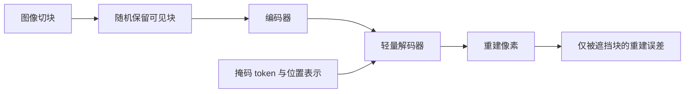

# MAE：只编码可见块，用轻量解码器重建被遮挡部分

> [!abstract] 模型定位
> MAE 是掩码重建式视觉预训练方法。重编码器只处理可见块，轻解码器结合可见表示与掩码 token 恢复像素；下游识别主要使用编码器。

## 一、输入输出与路径

原文高掩码比例降低可见冗余，同时减少重编码器处理的 token 数。不能误写成编码器先处理完整图像、之后才删去大部分表示。

## 二、关键设计与教学例子

> [!example] 教学情形
> 图像共有 196 个块，保留约四分之一给编码器；解码器接收这些可见表示和缺失位置的掩码 token。掩码 token 表示待恢复位置，不是真实隐藏像素。

解码器需要位置表示和恢复顺序，才能让输出对应原图位置。原文使用被遮挡块上的像素均方误差，也研究按块归一化的重建目标；两种目标要分清。

## 三、训练、迁移与边界

预训练的重建目标来自输入图像，不需要额外人工类别标签；下游微调或线性探测仍可使用相应任务标签。重建好看不自动代表分类最佳，线性探测与全量微调的趋势也可能不同。

高掩码比例在原文实验中有效，不能推出越遮越多越好。原文重建可以与唯一原图不同而仍具合理结构，也不等于已经建立可验证的世界模型。

自测：为何把 mask token 放在解码器而非重编码器？损失为何不能默认计算在所有块上？本人回答另记。

**出处：** [[He2021-Masked-Autoencoders-Are-Scalable-Vision-Learners.pdf]] 第 3–4.1 节、图 1/5，PDF 第 2–4 页。本轮定向核查，不沿用未重核的最佳分辨率精度。比较见 [[自监督三条路线对比]]。
