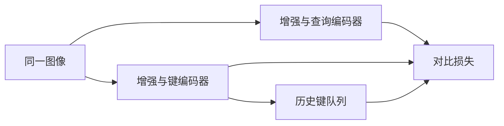

# MoCo：用队列与动量编码器构造对比字典

> [!abstract] 模型定位
> MoCo 是一种对比表征学习机制。队列使负样本字典不局限于当前批量，动量编码器使跨批量特征的变化较平缓。

## 一、输入与训练路径

同一图像经两种随机增强产生查询视图与正键视图，各自编码为 $q,k^+$；队列提供其他键作为对比项。损失要求查询在字典中识别对应正键。

## 二、队列与动量分别解决什么

队列依次加入新键、移出最旧键，字典大小可独立于批量大小设定。但旧键来自过去的编码器，如果表示快速改变，跨批量比较会变得不一致。

因此键编码器用查询编码器参数的指数移动平均更新：

$$
\theta_k\leftarrow m\theta_k+(1-m)\theta_q.
$$

只有查询编码器经当前损失反向传播更新，键特征停止梯度。动量更新的是编码器参数，不是把所有图像像素或所有历史特征逐项平均。

## 三、评价与使用边界

原文第 3.3 节将同图不同增强作为正对，不同图像作为负对，这是代理任务的构造，不等于不同图像必属不同语义类别。增强策略、字典大小、表示一致性都会影响所学特征。

下游可以冻结表示评价，也可以微调；训练用的队列不自动成为推理必需模块。不能把某个协议下的结果称为统一“模型精度”。

自测：去掉队列与去掉动量编码器分别改变什么？本人回答另记。

**出处：** [[He2019-Momentum-Contrast-for-Unsupervised-Visual-Representation-Learning.pdf]] 第 3.2–3.3 节、式 2、算法 1，PDF 第 3–4 页。本轮核对机制，未重核全部下游数字。比较见 [[自监督三条路线对比]]。
