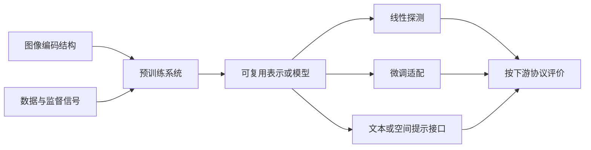

---

title: 视觉基础模型时代-2020至今

type: 索引卡

topic: 计算机视觉

tags: [计算机视觉/发展史, 主题/基础模型]

status: 精进中

created: 2026-11-13

updated: 2026-11-17

source: "北交大《视觉智能发展综述》(2025)；ViT / CLIP / SAM 原文；Uelwer 自监督综述；Ghosh VLM 综述"

variant: 阶段总览
---

# 视觉基础模型总览：预训练知识怎样被复用

> [!abstract] 框架认识
> 结构、训练信号和使用接口是三条不同坐标。ViT主要提供图像表示结构，CLIP展示图文监督与迁移，SAM围绕提示分割组织复用；它们没有组成一条能力必然递增的接班链。

**阅读入口：** [[#一、范围与核心问题|问题]] · [[#二、三条需要分开的坐标|坐标]] · [[#三、路线之间怎样联系|关系]] · [[#五、局限与深入入口|继续学习]]

## 一、范围与核心问题

如果每换一个数据集、类别集或交互需求都从零训练，成本很高。预训练先形成可复用表示，再通过输出头、微调或提示等方式适配。要判断复用是否成立，必须说明下游任务、使用了多少标注、改变了哪些参数及怎样评价。

文件名保留“2020至今”作为目录入口；正文依据本地ViT、CLIP、SAM、自监督原文及截至2025版本的综述，不声称覆盖此后的最新进展。MoCo等工作跨越分区时间边界，按知识关系保留在这里。

## 二、三条需要分开的坐标

### 2.1 结构：信息怎样在图像中交换

[[模型-ViT]]把图像切成块并编码为token，用Transformer建模关系。它改变图像处理结构，不自动决定监督来源；同样结构可以接受类别标签、自监督或图文信号。较少的图像特定归纳偏置也不等于没有任何结构假设。

### 2.2 信号：从哪里获得训练目标

[[模型-MoCo]]通过不同视图的对比学习表示，并用队列与动量编码器组织字典。[[模型-DINO]]用教师与学生的输出对齐，配合停止梯度及中心化、锐化等机制；[[模型-MAE]]让编码器处理可见块，再重建被遮挡内容。

三者都可归入[[自监督学习]]，但信息约束不同：辨认正负关系、匹配教师输出和恢复内容并非同一损失。为什么这些目标可能形成可迁移表示，见 [[自监督三条路线对比]]。

[[模型-CLIP]]则使用图文配对信号。自然语言监督减少了对固定类别标签的依赖，却仍受配对质量、覆盖和偏差影响，不能写成“完全无监督”。

### 2.3 接口：预训练成果怎样被调用

固定编码器后训练线性分类器是[[线性探测]]；更新预训练参数是[[微调]]；CLIP可把候选类别写成文本并比较相似度；[[模型-SAM]]接受点、框等提示输出掩码。

这些接口决定了使用者需要提供什么，也决定“零样本”“通用”究竟指什么。SAM默认提示分割能力与论文的探索性文本实验必须分开，不能因为“提示”二字相同就认为所有模型都直接听懂自然语言。

## 三、路线之间怎样联系

这张图描述设计维度，不把所有模型都强行套入同一输出方式。例如CLIP双编码器的图文相似度支持检索与类别文本比较；多模态生成模型还需要把视觉条件接到语言生成过程，不能由相似度机制直接推出对话能力。见 [[多模态大模型谱系]]。

[[通用性的三种含义]]把跨任务、跨分布与接口适应分开。一个模型可以在接口上灵活，却在新领域中失效；也可以生成流畅文本，却对图中细节判断错误。

## 四、关键变化与其他方向

预训练数据、监督形式、模型规模与适配方式共同改变复用成本。[[视觉数据的来源与成本]]提醒：标签少不代表数据免费，图文配对和交互标注同样有成本；[[规模定律]]提醒：规模收益要在受控条件和拟合范围内讨论。

传统几何、成像和任务评价仍有作用。基础模型可以提供候选、特征或交互入口，但不能代替标定、可靠性检查及具体输出定义。医学、机器人等只是可能应用，当前学习不默认围绕某一项目展开。

## 五、局限与深入入口

| 想弄清的问题 | 进入哪里 |
|---|---|
| 预训练与下游适配怎样衔接 | [[预训练-适配范式]] |
| 不靠类别标签，目标从哪里来 | [[自监督三条路线对比]]、[[综述-Uelwer-自监督表征学习]] |
| 图文匹配为什么不等于对话 | [[论文-Radford-CLIP]]、[[综述-Ghosh-视觉语言模型]] |
| 提示怎样决定分割对象 | [[论文-Kirillov-SAM]] |
| 怎样把阶段叙事当视角使用 | [[综述-视觉智能发展四阶段]] |

自测：给一个模型，分别写出结构、训练信号、输出接口和评价协议。换了提示后，哪些部分不用重算？“零样本”还需要什么已学知识？学生自答留待填写。

**证据边界：** 原始方法依据本区论文与模型档案。综述分类不是统一基准；本地Ghosh文件实际为2025-10-14的v4，保留文件名但按版本使用。未复现全部方法，也未认证所有前沿模型名录，详见 [[论文核读记录]]。
