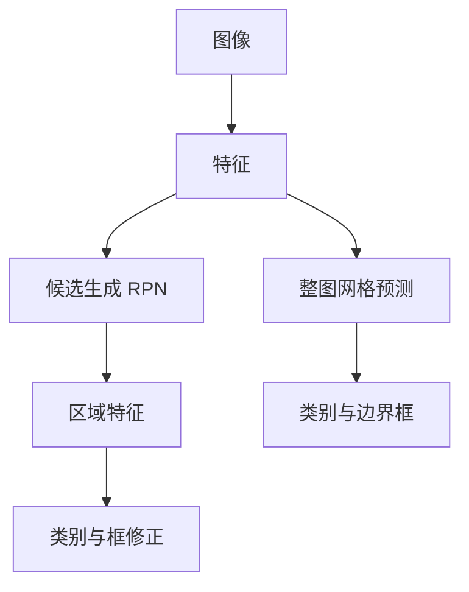

# 两阶段与单阶段检测：候选区域如何参与预测

> [!abstract] 核心区别
> 在这里比较的具体系统中，Faster R-CNN 先产生候选，再对候选作区域识别；YOLO v1 从整图特征直接给出网格预测。阶段划分关乎计算职责，不直接决定速度和准确率的普遍排名。

## 一、先把共同任务说明白

两条路线都要输出目标类别和边界框，也都可能需要筛选重复预测。它们不是“一个用网络、一个不用网络”，也不是“一个输出框、另一个输出像素”。

## 二、沿两条信息路径看区别

上半路径对应 Faster R-CNN：RPN 的目标性先定位值得进一步识别的区域，检测头再分类与修正。下半路径对应 YOLO v1：网格和框预测器承担直接输出的组织方式。该示意仅比较这两个系统，不涵盖所有后来方法。

## 三、具体例子与约束

一张图有两只相邻小鸟。候选路线需要候选覆盖两只鸟，之后区域头分别识别；候选遗漏会影响后续结果。YOLO v1 则受网格分配、同单元类别共享和粗特征制约，邻近小目标可能难以表示。

这个教学例子说明潜在瓶颈，不证明任何一条路线对小目标必然更优。特征分辨率、样本、损失和训练都会影响结果。

| 比较点 | Faster R-CNN 原文框架 | YOLO v1 |
|---|---|---|
| 中间候选 | 显式 RPN 候选 | 无独立的区域候选识别阶段 |
| 局部预测 | 区域汇总后分类及框修正 | 网格输出框及共享类别概率 |
| 训练分配 | 锚框、RoI 与真值的关联 | 中心归属和负责预测器选择 |
| 后处理 | 候选与检测筛选 | 分数筛选与重复框处理 |

## 四、怎样读速度、精度与误差分析

比较需要固定数据集、训练数据、骨干、分辨率、评价协议和硬件。YOLO 原文第 4.2 节在 VOC 2007 的特定 top-N 协议下观察到其定位错误较多、背景误检较少；不能据此断言所有单阶段都如此。

[[模型-Mask R-CNN]] 在两阶段路径上增加掩码分支并改进对齐，说明阶段框架可以承接不同输出任务。它不是用掩码分支替换所有候选机制。

## 五、自测与来源

自测：共享骨干为什么仍可称为两阶段？使用 NMS 能否作为阶段划分标准？更换骨干后能否沿用原来的速度结论？本人回答另行填写。

**来源：** [[Ren2015-Faster-R-CNN.pdf]] 第 3 节、图 2/3；[[Redmon2016-YOLO-You-Only-Look-Once.pdf]] 第 2、4.2 节；[[He2017-Mask-R-CNN.pdf]] 第 3 节。本轮按上述机制定向核查，未做跨框架统一复现实验。
