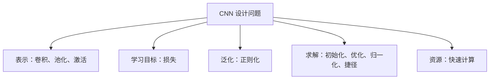

# Gu 等 CNN 综述：把改进分解为可理解的组件

> [!abstract] 综述主线
> 作者不只按模型年代排列 CNN，而是从层设计、激活、目标、正则化、优化与计算效率组织改进。阅读价值在于看清各组件处理什么问题，而非从模型名录中直接选冠军。

## 一、范围与主要困难

论文讨论其发表时期 CNN 的基本组件、改进方法和应用。输入经卷积与非线性变换得到特征，再按任务输出类别或其他结果；模型需要兼顾表示能力、优化可行性、泛化与计算资源。

**这些困难不能互相替代。** 增大容量不保证容易训练，训练误差下降也不保证泛化改善，参数更少不保证特定硬件上更快。

## 二、作者怎样组织材料

第 2 节解释基础组件，第 3 节按卷积、池化、激活、损失、正则化、优化组织改进，第 4 节讨论快速计算，第 5 节汇总应用。以下是对作者结构的归纳，不是整个视觉领域的互斥分类。

## 三、从组件理解工作方式

### 3.1 卷积、非线性与池化

卷积在不同空间位置共享核参数，提取局部模式；非线性使多层组合超出单纯线性映射；池化汇总局部响应并可能降低分辨率。三者经常配合，但用途不同。

共享卷积有位置结构，并不自动让分类结果对任意平移、旋转或尺度都完全不变。池化可能增加一定局部变化容忍，也会损失位置细节；需要定位或掩码输出时，这种取舍尤其重要。

### 3.2 目标、正则化与优化

损失说明希望模型对什么误差付出代价；正则化约束模型或训练过程；优化算法根据梯度寻找参数。以 [[Dropout]] 为例，训练随机屏蔽部分输出与“改变类别交叉熵定义”不是同一件事。

第 3.6.4 节介绍 [[批归一化]] 的标准化与可学习仿射变换，第 3.6.5 节讨论捷径。原文将若干收益与机制动机联系起来，笔记需要区分作者解释和已经核实的实验事实。

### 3.3 结构与快速计算

第 4 节讨论如何在可接受成本下处理更复杂模型和更大数据。例如在频域处理卷积可复用某些变换，但是否更快依赖尺寸、实现与硬件，不能把某算法名称直接当作速度保证。

## 四、联系与边界：用一个问题串起来

> [!example] 教学情形：分类改成实例分割
> 分类可以汇总整图语义，实例分割还需保持空间对应。这时不能只寻找“分类精度最高的层”，还要审查分辨率、区域对齐、输出目标及监督方式。

同一组件可服务多种任务，同一模型也可组合多个改进维度。[[论文-He-ResNet]] 的捷径与 [[模型-GoogLeNet]] 的分支不是简单替代关系；前者重点改变局部映射的参数化，后者组织分支与计算预算。

## 五、未解问题与阅读入口

综述不能证明其全部引用数字在统一协议下可比。涉及具体机制与指标时应回到原文；应用列表也不等于每个模型对所有应用都已经验证。

自测：怎样区分优化困难与泛化困难？为什么减少分辨率既可能省计算也可能妨碍定位？本人回答另记。

**来源与范围：** [[Gu2018-Recent-Advances-in-Convolutional-Neural-Networks.pdf]]，本地 arXiv v6 文本；本轮定向核对 PDF 第 1–3 页、3.6.3–3.6.5 节（第 15–16 页）和第 4 节开头（第 17 页）。未逐一核对所有应用、引用或实验数字，不记为全文精读完成。
