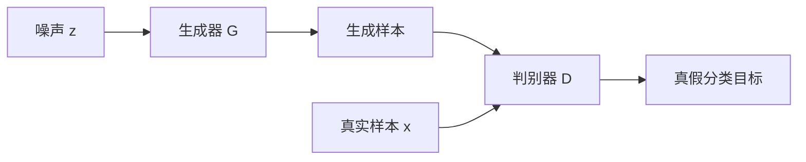

# GAN：用可训练的判别器为生成器提供学习信号

> [!abstract] 核心认识
> 原始 GAN 把生成分布的学习组织为生成器与判别器的博弈。它允许通过采样训练隐式生成模型，但理想分布空间的最优性不能直接当作有限神经网络训练的收敛保证。

## 一、研究问题与必要背景

图像分类学习“图像到类别”；生成模型则希望产生符合数据分布的新样本。若从噪声 $z$ 经可微函数 $G$ 得到图像，采样本身很直接，困难是怎样判断并改善生成分布 $p_g$ 与真实分布 $p_{data}$ 的差别。

本文不要求先写出可计算的精确生成密度，而是引入判别器 $D(x)$：估计样本来自真实数据而非生成器的概率。这不是给每张图像评“艺术分”，而是在真实与生成样本的二分类任务上建立学习信号。

## 二、训练的两条路径

训练判别器时，真实样本标为真，生成样本标为假；训练生成器时，判别器参与前向与梯度计算，但更新的是生成器参数。**冻结判别器参数，不等于切断经判别器传给生成器的梯度。**

推理采样时只需 $z\sim p_z$ 和 $G(z)$，不需要判别器，也不需要为本框架执行马尔可夫链采样。

## 三、从目标函数走到理论最优

### 3.1 两个网络优化什么

原文式 1 写成：

$$
\min_G\max_D V(D,G)=\mathbb E_{x\sim p_{data}}\log D(x)+\mathbb E_{z\sim p_z}\log(1-D(G(z))).
$$

第一项鼓励判别器将真实样本判为真，第二项鼓励其把生成样本判为假；生成器改变 $G(z)$，试图改善自己在该博弈中的目标。期望表示对随机样本的平均，不是只训练一对固定图像。

### 3.2 为什么最优判别器具有密度比形式

固定 $G$ 后，把生成样本的期望改写为对 $p_g$ 的积分。在某个位置 $x$，需要最大化：

$$
a\log d+b\log(1-d),\quad a=p_{data}(x),\ b=p_g(x).
$$

在 $a,b>0$ 的内部情形，求导得到 $a/d-b/(1-d)=0$，所以：

$$
D^*(x)=\frac{p_{data}(x)}{p_{data}(x)+p_g(x)}.
$$

若某个密度为零，最优值可处于边界；当两者均为零时，该处不影响目标。这个推理依赖理想函数空间，不表示训练中判别器已经达到此值。

### 3.3 为什么分布相同是理想最优点

令 $m=(p_{data}+p_g)/2$，将 $D^*$ 代入目标并拆开对数，可得到原文式 5/6：

$$
C(G)=-\log4+KL(p_{data}\Vert m)+KL(p_g\Vert m)
=-\log4+2JSD(p_{data}\Vert p_g).
$$

两项 KL 组成 Jensen–Shannon 散度；散度非负、分布相同时为零，故理想目标在 $p_g=p_{data}$ 时取最小值。此时最优判别器在相关支撑上为 $1/2$。

> [!warning] “判别器输出 0.5”不是独立的成功判据
> 判别器未训练好也可能接近随机猜测。需要区分理想最优判别器的性质与有限训练过程中的观测。

## 四、实际训练为何不同于理论设定

算法 1 交替更新判别器和生成器。第 4.2 节的收敛讨论要求足够容量、每步判别器达到最优，以及在分布空间作适当小更新；实际训练更新的是神经网络参数，存在多种临界点。作者明确承认不能将理想论证直接用作参数训练保证。

训练初期生成样本容易被识别，原始生成目标可能提供较弱梯度。第 3 节因此提出让生成器改为最大化 $\log D(G(z))$，即最小化其负值。它保持所讨论的理想固定点，但实际优化形式与原始 minimax 目标不同。

## 五、实验支持与评价边界

第 5 节在 MNIST、TFD 和 CIFAR-10 展示实验。表 1 使用**从生成样本拟合的高斯 Parzen 窗**估计测试集对数似然；这不是直接计算 GAN 的精确密度。核宽度经验证选择，TFD 与 MNIST 的误差条口径也不同。

作者指出此估计方差较高、高维表现有限，因此不能把表中数值概括为对视觉质量、多样性和语义正确性的全面认证。图 2 给出生成样本及近邻训练样本，辅助观察样本性质，仍不等于形式化排除一切记忆行为。

## 六、边界、自测与来源

原始无条件框架不自动提供按类别控制生成的接口；条件化是本文讨论的扩展方向。后续 GAN 变体和其他生成范式的比较需要各自证据，本篇不替它们下结论。

- 为什么训练生成器时仍要通过判别器反传？
- 最优判别器的推导在哪些情形需要边界处理？
- 理想全局最优与有限神经网络训练收敛为什么是两件事？

本人回答另行填写。流程速查见 [[模型-GAN]]，术语见 [[生成对抗网络]]。

**来源与核查范围：** [[Goodfellow2014-Generative-Adversarial-Networks.pdf]] 第 1、3–5 节，式 1–6、算法 1、表 1 及图 2 说明，PDF 第 1–6 页定向查阅。未复现实验，未以本文认证后续变体或现代评价指标。
