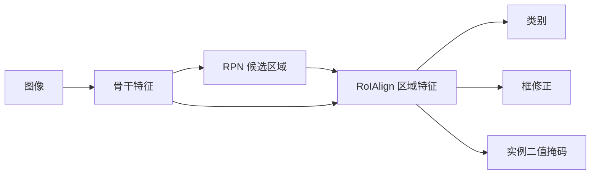

# Mask R-CNN：在检测实例的同时保留像素对应关系

> [!abstract] 核心认识
> Mask R-CNN 在两阶段检测中加入掩码分支，并通过 RoIAlign 减少区域特征的空间错位。分类决定实例类别，二值掩码学习实例内部的前景布局。

## 一、从检测到实例分割，困难在哪里

检测给出类别和矩形框，实例分割还要给出每个对象的像素区域。一个框可以覆盖大量背景，也可能与其他对象重叠；仅有框坐标不足以描述轮廓。

论文沿用 Faster R-CNN 的候选区域流程，但掩码预测比整区域分类更依赖精确空间对应。因此，新增输出分支和改善区域特征对齐需要一起考虑。

## 二、整体机制与三个输出

图表示概念数据路径。本文部分消融为方便比较单独训练 RPN，不能把示意图解读成每个实验都使用同一联合训练配置。

## 三、RoIAlign 为什么不能只解释成插值

RoIPool 将连续区域边界、分箱位置量化到离散特征网格，可能使提取的特征与原区域错位。分类往往容忍小平移，但像素掩码需要保留细粒度对应。

RoIAlign 保留连续坐标，在分箱内选采样点，通过双线性插值从相邻网格值计算采样值，再汇总。关键是**不先量化边界与分箱**，不是只要用了插值就自动对齐。

> [!example] 教学直觉
> 一个区域边界落在特征坐标 2.4 时，若先取整为 2，后续再插值也不能自动恢复已丢失的边界位置。保留 2.4 才能按原连续位置采样。

具体定义见 [[RoIAlign]]；插值是计算采样值的方法，不是额外学习一个独立像素标签。

## 四、掩码目标怎样与分类解耦

每个 RoI 的损失为：

$$
L=L_{cls}+L_{box}+L_{mask}.
$$

前两项分别承担类别识别与框修正。默认掩码分支产生 $K$ 个 $m\times m$ 二值掩码，每个类别一个；各像素使用 sigmoid，训练时只对真值类别 $k$ 对应的掩码计算二元交叉熵。

为什么只监督这一张？分类分支已经判断整个实例属于哪类，掩码分支只需学习“这个实例的前景在哪里”，不必让每个像素在全部类别之间竞争。原文表 2b 比较这种方式与逐像素 softmax，支持所考察设置中的解耦收益。

**掩码损失只用于正 RoI。** 不能把所有背景候选都当成带完整前景掩码的训练对象。

## 五、训练、推理和实验边界

训练时，正 RoI 关联真值类别、框及实例掩码。推理时先运行框预测与筛选，再对较高分检测计算掩码，用预测类别选择相应掩码，缩放回实例区域后得到输出。第 3.1 节给出的推理调度与训练中的概念并行结构有所不同。

表 2c 在 COCO trainval35k 训练、minival 测试、ResNet-50-C4 骨干下比较 RoI 层：RoIPool 的 mask AP 为 26.9，RoIAlign 平均汇总为 30.3。RoIWarp 同样使用双线性采样但仍量化区域，结果接近 RoIPool；因此对照支持对齐的重要性，不能只归因为插值。

表 1 是 COCO test-dev 上不同骨干的实例分割结果；与表 2 的消融数据划分不同。mask AP、box AP、AP50、AP75 不能混作一个“精度”。

## 六、自测与来源

本方法以候选实例为中心预测局部掩码，仍依赖候选质量、类别和框预测；对齐改进不是对所有遮挡、细边界或域偏移的保证。

- 为什么先量化再插值不等于 RoIAlign？
- 为何训练只对真值类别通道计算掩码损失？
- 推理中选掩码类别与训练中使用真值类别有何区别？

本人回答留待填写。整体速查见 [[模型-Mask R-CNN]]，前置流程见 [[模型-Faster R-CNN]]。

**出处与核查范围：** [[He2017-Mask-R-CNN.pdf]] 第 3、3.1、4.1–4.2 节、图 3/4、表 1/2，PDF 第 3–6 页定向核对。未逐项复核后续扩展、关键点实验或全部附录，未复现代码。
