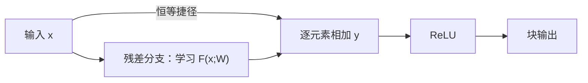

# ResNet：把深层网络改写为对输入的逐步调整

> [!abstract] 核心认识
> 本文针对加深普通网络后**训练误差反而升高**的退化现象，引入残差参数化：先保留输入，再学习调整量。原文以受控对照支持其优化收益，没有证明任意深度或任务都受益。

**阅读入口：** [[#一、研究问题：更深为什么没有拟合得更好|问题]] · [[#三、残差参数化与信息路径|机制]] · [[#五、实验怎样检验主张|证据]]。

## 一、研究问题：更深为什么没有拟合得更好

图像分类的输入是图像，输出是类别预测。增加网络深度通常被期待能学习更复杂的映射，但作者发现，一些更深的普通网络连训练集都没有拟合得更好。这个现象称为 [[退化问题]]。

**先看训练误差，而不只看测试误差。** 如果训练表现很好、测试表现差，可能涉及泛化与过拟合；本文讨论的退化在训练阶段已经显现。论文第 1 节及图 1 用 CIFAR-10 展示这一差别，第 4.1 节又在 ImageNet 比较普通网络与残差网络。

## 二、从恒等映射得到设计动机

假设已经有一个训练好的较浅网络。若新增层能够保持输入，并复制原有层的参数，就可以构造出保留原网络功能的较深网络。这个讨论依赖新增部分能够实现所需映射，不能无条件推广到所有架构。

这样便出现区别：**存在一个不差的解，不等于当前求解器容易找到它。** 作者据此将注意力放在参数化与优化上，而非单纯增加表达容量。

作者考虑让新模块以恒等映射为参照学习变化。若某个模块需要的变换接近“保持原样”，学习小调整可能更方便。这是第 3.1 节提出的设计解释，是否更容易优化仍需实验检验。

## 三、残差参数化与信息路径

### 3.1 为什么引入残差函数

设输入为 $x$，局部模块希望拟合的映射为 $H(x)$。当输入输出形状一致时，将待学习函数改写为：

$$
F(x)=H(x)-x,\qquad y=F(x;W)+x.
$$

$W$ 是残差分支的参数，$F$ 表示相对于输入的调整量，$y$ 是相加位置的结果。代数上加回 $x$ 就恢复目标形式；**这只说明表达方式的关系，不证明优化一定更容易。**

任务监督并没有改成“为每一层提供残差标签”：仍从网络最终分类损失反向传播，训练可学习参数。

图中两条分支的作用不同：捷径直接传递输入，残差分支学习变换；它们汇合之后，原论文基本块还执行激活。该图对应形状一致的块，非所有下采样情况。

> [!example] 教学示例：在输入上作微小调整
> 输入为 3，期望相加结果为 3.2，则残差分支需给出 0.2；若希望保持输入，需给出 0。
>
> 这些是说明参数化的自拟数值，不是论文实验，也不是对优化速度的证明。

### 3.2 形状不一致怎么办

逐元素相加要求通道数和空间尺寸对应。形状变化时，一种做法是用可学习投影 $W_s$ 对齐：

$$
y=F(x;W)+W_sx.
$$

第 3.3 节介绍用 $1\times1$ 卷积实现投影；空间分辨率变化时配合步幅。论文也考察了补零的参数无关捷径，不能把投影当作唯一方案。

### 3.3 基本块与瓶颈块

18/34 层配置使用两层 $3\times3$ 卷积的基本块。50/101/152 层配置使用 $1\times1\rightarrow3\times3\rightarrow1\times1$ 的瓶颈块：先降低通道维度，在较窄的表示上做空间卷积，再恢复维度，以控制计算和训练成本。具体层数与通道见表 1，结构对照见图 5。

> [!warning] 恒等捷径不等于整个块都是恒等映射
> 原论文基本块相加后还有 ReLU。即使 $F(x;W)=0$，相加结果是 $x$，完整块输出仍为 $\operatorname{ReLU}(x)$。不能据此声称梯度在所有输入处都不会被激活函数影响。

## 四、训练与推理的区别

ImageNet 训练采用数据增强后的图像裁剪、分类监督与 SGD；卷积后、激活前使用批归一化。第 3.4 节说明了训练设置，并区分比较实验的 10-crop 测试与最佳结果所用的多尺度测试。

训练中参数通过分类损失更新；推理中参数固定，图像经过卷积阶段、全局平均池化和分类层得到预测。比较结果时必须保留测试协议，不能把 10-crop、多尺度、单模型和集成结果混用。

## 五、实验怎样检验主张

### 5.1 同深度对照与加深对照

表 2 在 ImageNet 2012 验证集比较分类 top-1 错误率，采用 **10-crop**。这里的残差配置采用无额外可学习参数的捷径方案 A。

| 深度 | 普通网络错误率 | 残差网络错误率 |
|---|---:|---:|
| 18 层 | 27.94% | 27.88% |
| 34 层 | 28.54% | 25.03% |

**看图 4 的训练曲线，再看表 2 的验证误差。** 普通网络由 18 层加深到 34 层时训练误差更高；残差网络则在所考察设置中改善训练与验证表现。图 4 的曲线使用中心裁剪评价，表 2 是 10-crop 汇总，二者用于互相说明，不能当作完全同一指标序列。

第 4.1 节报告，使用 BN 的普通网络具有非零前向信号方差及健康的反向梯度范数，因此作者认为退化不太可能仅由梯度消失解释。这个观察不构成“所有深层网络都不存在梯度问题”的定理。

### 5.2 投影、深度与测试协议

表 3 比较 A（升维补零）、B（仅升维处投影）、C（全部投影）。三者都优于对应普通网络，说明在这些设置下额外投影参数不是产生收益的必要条件；不意味着实际模型永远不需要投影。

152 层模型在表 3 的 ImageNet 验证集 **10-crop top-5 错误率为 5.71%**；表 4 改用论文的最佳单模型推理设置，**验证集 top-5 错误率为 4.49%**；表 5 的 **3.57%** 则是 ImageNet 测试集上的集成结果。前两者都在验证集，但推理协议不同；第三者还改变了数据划分与模型组合。不能只保留最小数字来代表任意 ResNet。

## 六、局限、自测与证据入口

残差参数化为所研究网络提供了优化收益，不保证更深一定更好；它也不能单独消除数据不足、过拟合或任务不匹配。后续结构的变化应另查对应论文，本篇不据原文推断谁“接替”了谁。

- 为什么要同时查看训练误差和验证误差？
- $F(x;W)=0$ 时，相加位置与激活后输出是否总相同？
- 表 3、表 4 和表 5 的数字为什么不能直接互换？

本人回答留待填写。模型速查见 [[模型-ResNet]]，定义回查见 [[残差连接]]。

**来源与核查范围：** [[He2016-Deep-Residual-Learning-ResNet.pdf]]，第 1、3.1–3.4、4.1 节，图 2/4/5、表 1–5；本轮定向查阅 PDF 第 1、3–7 页，并视觉核对第 5 页图表。未完整核读 CIFAR-10、检测附录及全部引用，未复现实验；旧版完整正文保存在本轮原稿备份中。citekey 未经 Zotero 核对，故不沿用预填值。
