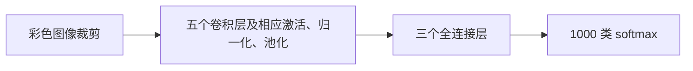

# AlexNet：把大规模卷积分类网络训练起来

> [!abstract] 核心认识
> 论文结合卷积表示、ReLU、GPU 训练、数据增强与 Dropout，在大规模有标签图像分类上取得结果。需要把模型结构、训练条件和评价协议一起理解，不能只记住一个竞赛数字。

## 一、任务与困难

任务是从彩色图像预测类别。卷积网络用局部连接与共享卷积核提取空间模式，减少相对全连接图像映射的参数负担；但较大的模型仍面临计算、显存与过拟合问题。第 1–2 节说明数据规模和硬件为何是本文的重要条件。

论文在 ILSVRC 的分类子集上训练和评价。完整 ImageNet 与竞赛子集不是同一数据口径；不能把全部数据库的类别数写成本文分类头的类别数。

## 二、整体流程：从局部模式到类别

图表示原文的整体层级，不意味着每层后都有归一化或池化。第 3.5 节给出：响应归一化跟随第一、第二卷积层，相应池化及第五卷积层后的池化按图 2 布置。

卷积层把局部像素组合成可学习特征，全连接层将空间表示用于整图分类。输出是整图类别分布，**不是目标框或分割掩码**。

## 三、关键设计怎样回应训练困难

### 3.1 ReLU 与优化

ReLU 定义为 $f(x)=\max(0,x)$。正输入一侧保持线性，不像饱和激活那样在该区域将导数压得很小；负输入一侧为零，所以它并非在所有区域都保持非零梯度。

图 1 使用 CIFAR-10 上特定四层网络比较达到 25% 训练误差的迭代速度。该对照支持所测设置下的训练收益；**不能改写成 ImageNet 主网络在任何条件下都快六倍**。

### 3.2 双 GPU、归一化与池化

显存限制促使作者把网络分布到两张 GPU，并只在特定层交换信息。这是具体的连接和计算安排。单卡对照还涉及卷积核数量变化，不能把精度差全部归因于“用了两张卡”。

局部响应归一化在同一空间位置跨邻近通道计算归一化因子，形成响应之间的竞争；它与后来的批归一化不是同一个机制。重叠池化令池化窗口大于步幅，使相邻输出依赖重叠区域。第 3.3–3.4 节给出定义与对照，不表示这些组件在所有架构中都必需。

## 四、数据增强与 Dropout 怎样约束过拟合

随机裁剪、水平翻转及颜色扰动为训练引入变化；它们依赖变换保持所需标签语义，不能自动照搬到任意任务。

第 4.2 节在前两个全连接隐藏层使用 [[Dropout]]：训练时随机将部分输出置零，让单元不能固定依赖某一组其他单元。原文以 0.5 概率丢弃，并在测试时使用全部单元、将输出乘以 0.5。必须分清这里的训练与测试约定，不能只抄“随机删神经元”。

> [!example] 教学情形
> 某次训练暂时屏蔽一个隐藏单元，其输出不参与该次前向和相应反向路径；下一次它可能重新参与。权重没有被永久删除，也没有每次从头训练一个新网络。

## 五、训练目标与实验依据

训练最大化正确类别的对数预测概率，等价于最小化相应分类交叉熵：

$$
L=-\frac1N\sum_{i=1}^{N}\log p(y_i\mid x_i).
$$

这里 $x_i,y_i$ 为训练样本与标签，$p$ 来自 softmax。公式是对原文第 3.5 节目标的标准记号重述，不是新的监督方式。第 5 节说明带动量 SGD、权重衰减及学习率调整。

| 结果 | 数据集与协议 | 原文位置 |
|---|---|---|
| 单 CNN：验证集 top-5 错误率 18.2% | ILSVRC-2012，单模型，原文规定的预测平均设置 | 表 2、第 4.1/6 节 |
| 测试集 top-5 错误率 15.3% | ILSVRC-2012，七模型组合，其中部分使用额外预训练 | 表 2、第 6 节 |

两行不能互换。第 4.1 节测试采用五个位置裁剪及其水平翻转，共十个图块，平均 softmax 预测；这是推理时的预测组合，与训练中随机裁剪的作用不同。

## 六、边界与自测

本文展示了特定数据规模与训练条件下大规模 CNN 的有效性，没有给出“达到某个样本量就必胜手工特征”的阈值，也不能据此认定后续架构的优劣。历史意义与机制解释应分开。

- 为什么整图分类网络不能直接输出目标位置？
- Dropout 的训练与测试过程分别改变什么？
- 为什么 15.3% 不代表任意单模型配置？

本人回答另行填写。流程速查见 [[模型-AlexNet]]，激活定义见 [[ReLU]]。

**来源与核查范围：** [[Krizhevsky2012-AlexNet-ImageNet-Classification.pdf]] 第 2–6 节、图 1/2、表 2，PDF 第 2–7 页定向查阅；未复现训练，未逐项重核所有结构尺寸及消融数值。原稿保存在本轮备份中。
