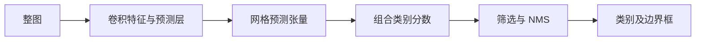

# YOLO v1：直接从整图预测类别与边界框

> [!abstract] 核心认识
> YOLO v1 将检测组织为整图上的联合预测：按目标中心分配网格单元，由网络输出边界框和类别相关分数。统一前向流程带来速度优势，也引入网格表达和定位精度的约束。

## 一、检测问题与本文改变

目标检测需要同时回答“是什么”和“在哪里”。此前一些系统先产生候选区域，再逐区域识别。YOLO v1 直接由整图特征预测所有网格的输出，使特征和预测目标一起训练。

“单次网络计算”描述其主要预测过程，不表示没有分数筛选和重复检测处理，也不表示后来的所有 YOLO 版本与本文结构相同。

## 二、从图像到预测张量

原文将图像划成 $S\times S$ 网格，目标中心所在单元负责该目标。每个单元预测 $B$ 个框，每框包含中心位置、宽高与置信度共 5 个值；同一单元还预测一组 $C$ 类条件概率。因此输出形状为：

$$
S\times S\times(5B+C).
$$

VOC 配置取 $S=7,B=2,C=20$，得到 $7\times7\times30$。这是**每个单元一组类别概率**，不是每个框都有独立的一组类别概率。

> [!example] 教学计算
> 每个单元输出 $2\times5+20=30$ 个值。全图未经筛选共有 $7\times7\times2=98$ 个框预测；98 不是最终检测到的目标数量。

## 三、坐标、置信度与类别怎样关联

### 3.1 预测值各自表示什么

$x,y$ 表示相对于所属网格的中心偏移，$w,h$ 相对于整图宽高归一化。原文将框置信度定义为 $P(Object)\times IoU$；推理时再与 $P(Class_i\mid Object)$ 相乘，形成类别相关分数。

IoU 反映框的重叠质量，见 [[交并比]]。这个分数将存在性、类别与定位质量联系起来，不能简单当作已经校准的“该类别概率”。

### 3.2 为什么要分配负责的预测器

同一网格有多个框预测器。训练时，针对目标选择当前与真值 IoU 最高的预测器承担相应框坐标学习，让不同预测器形成分工。**中心决定网格，IoU 决定该网格内哪个预测器负责**，二者不能混写。

## 四、损失怎样回应不平衡和尺度

第 2.2 节采用多项平方误差，包含坐标、目标框置信度、无目标置信度和类别项。类别误差只在有目标单元计算，坐标误差只在负责的预测器上计算。

大量无目标预测容易主导训练，因此作者降低无目标项权重、提高坐标项权重；宽高项比较平方根，试图缓解大框与小框误差的尺度差异。平方根改变了小宽高处的误差敏感度，但**不等于损失已经精确优化 AP 或 IoU**。作者在第 2.4 节仍指出定位问题。

推理时组合分数并处理重复框，[[非极大值抑制]] 属于这一阶段；它不同于训练时的负责预测器分配。

## 五、实验与局限怎样对应

第 4 节在 PASCAL VOC 上比较检测质量、速度与错误类型。表 1 的 mAP、FPS 必须附具体模型和训练集，不能把论文测试环境中的速度推广到其他硬件或现代 YOLO。

图 4 用 VOC 2007 每类 top-N 检测分析错误，N 为该类目标数量，再对类别汇总。原文观察到 YOLO v1 定位错误较突出、背景误检相对较少；这是该协议下与 Fast R-CNN 的对照，不是整个单阶段与两阶段家族的定律。

> [!warning] 本文的结构边界
> 同一网格共享类别预测，邻近小目标和拥挤排列较难表示；较粗特征也影响精细定位。更多框、更换分辨率或另一个版本的设计需要单独验证，不能用 v1 的观察直接解释。

## 六、自测与来源

- 为什么输出维度是 $5B+C$，不是 $B(5+C)$？
- 网格归属与负责框预测器分别怎样确定？
- 为什么 98 个框预测不等于 98 个最终目标？

本人回答另行填写。结构速查见 [[模型-YOLO]]，路线比较见 [[检测两阶段与单阶段的分岔]]。

**出处与核查范围：** [[Redmon2016-YOLO-You-Only-Look-Once.pdf]] 第 2–4 节、式 1–3、图 2/3/4 和表 1，PDF 第 2–6 页定向查阅。未复现速度或全部数据集实验，未核查后续 YOLO 版本。
