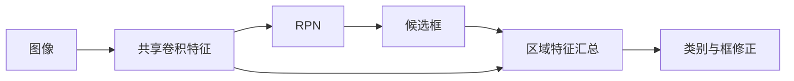

# Faster R-CNN：共享特征上的候选生成与区域识别

> [!abstract] 模型定位
> 两阶段检测框架：RPN 先提出可能含目标的区域，区域检测头再判断类别并修正边界框。两阶段描述计算职责，不是必须使用两个彼此独立的特征提取网络。

## 一、输入输出与整体流程

输入为图像，输出为检测类别、边界框及分数。RPN 的 objectness 区分目标与背景，第二阶段的类别预测区分具体类别；二者不能互换。

## 二、锚框如何使候选可学习

在特征图每个位置放置多尺度、多宽高比的参考框，即 [[锚框]]。网络预测每个锚框的目标性和坐标变换，形成候选。原文默认三尺度、三比例得到每位置九个锚框；这是配置，不是锚框定义。

为让位移相对参考尺寸表达，原文式 2 使用：

$$
t_x=(x-x_a)/w_a,\qquad t_w=\log(w/w_a),
$$

纵向同理。$x,w$ 是预测框中心与宽度，$x_a,w_a$ 属于锚框。相对位移按参考宽度归一化，尺度变化用比例的对数表示。

> [!example] 教学计算
> 锚框中心为 10、宽为 4，预测中心为 12、宽为 8，则 $t_x=0.5$、$t_w=\log2$。这些是变换参数，不是最终像素坐标。

## 三、训练与推理

训练依据锚框与真值的重叠分配正负或忽略样本；RPN 分类项学习目标性，回归项只对正锚框生效。候选框并不都具有有效的目标坐标监督。

原文讨论交替训练以共享特征；本地扩展版还提及联合训练。复现时必须确定版本和训练方案。推理对候选与最终检测作相应筛选，不能将锚框数、候选数和最终目标数混为一谈。

## 四、适用条件与自测

候选机制便于对区域作进一步识别，但最终结果依赖候选覆盖、特征分辨率和区域处理。两阶段不意味着在所有硬件或任务下更慢或更准。

自测：objectness 能否直接给出具体类别？为什么回归项不对所有负锚框计算？本人回答另记。

**出处：** [[Ren2015-Faster-R-CNN.pdf]]，本地 14 页扩展版第 3.1–3.2 节，式 1/2、图 2/3；本轮定向核查 PDF 第 2–5 页，未重测速度或全部实验。路线对照见 [[检测两阶段与单阶段的分岔]]。
