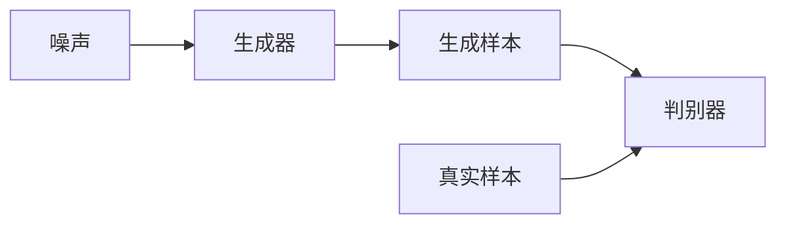

# GAN：生成器采样，判别器提供训练信号

> [!abstract] 模型定位
> 原始生成对抗网络是一种生成建模框架，训练时让两个网络相互作用，生成时从噪声直接产生样本；它不是固定的单一卷积架构。

## 一、问题、输入与输出

生成器 $G$ 输入从先验分布采样的噪声 $z$，输出与数据空间对应的样本；判别器 $D$ 输入真实或生成样本，输出来自真实数据的概率估计。

> [!example] 教学情形
> 对手写数字建模时，训练材料是真实数字图像；生成器从随机向量产生数字图像。原始无条件接口并没有接收“指定生成 7”的类别输入。

## 二、训练与生成流程

训练 $D$ 时提高真假分类能力；训练 $G$ 时固定 $D$ 的参数，通过 $D$ 对输入的梯度改进生成器。算法 1 采用交替更新，实验使用判别器更新次数 $k=1$；这不是对所有任务都合适的固定规则。

推理只使用生成器：采样噪声并执行前向映射。判别器不属于必要采样链路。

## 三、机制与限制

对抗目标让判别器成为学习信号来源，省去必须先写出易算精确密度的要求。但参数化生成器可以采样，并不等于其精确密度容易计算。

理想最优时 $p_g=p_{data}$、最优判别器为 $1/2$；相关结论依赖函数空间和优化条件，不能保证有限网络交替训练稳定收敛。完整推导见 [[论文-Goodfellow-GAN]]。

## 四、评价、条件与自测

原论文用生成样本和 Parzen 窗近似评价探索可行性，未给出覆盖质量、多样性与语义可靠性的统一保证。实际应用需要另查相应数据、任务和训练证据，不能从“图像看起来像”推断下游性能。

自测：没有判别器能否从训练好的生成器采样？冻结判别器参数时，为什么仍能训练生成器？本人回答留待填写。

**出处：** [[Goodfellow2014-Generative-Adversarial-Networks.pdf]] 第 3–5 节、算法 1；本轮核查边界见 [[论文-Goodfellow-GAN]]。
