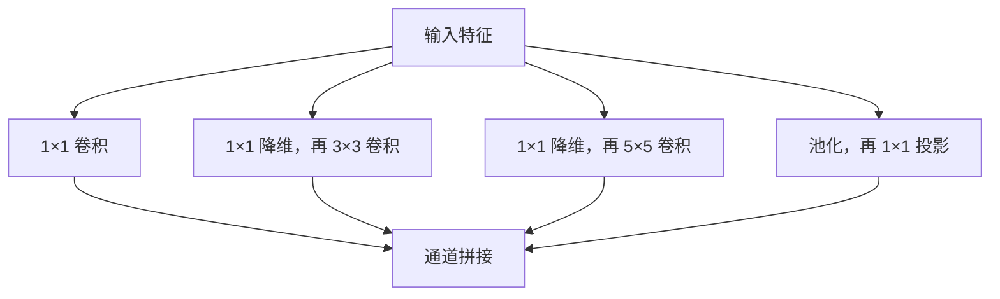

# GoogLeNet：用并行分支组织计算预算

> [!abstract] 模型定位
> GoogLeNet 是原论文中的一种 Inception 网络实例。Inception 模块组合不同空间范围的分支，并在昂贵卷积前用 $1\times1$ 卷积降维，控制表示宽度与计算成本。

## 一、为什么不直接把所有层都加宽

卷积输入输出通道都增加时，计算量可能显著增长。原文讨论在有限资源下安排连接与计算，而非无条件扩大每一层。

模块让同一输入通过不同卷积和池化分支，随后沿通道维拼接，供下一阶段组合多种空间范围的信息。

该图对应论文图 2b 的模块思路，拼接前需要空间尺寸可兼容；它不是 [[残差连接]] 的逐元素相加。

## 二、降维怎样降低成本

$1\times1$ 卷积在每个空间位置混合通道。当其输出通道更少时，后续 $3\times3$ 或 $5\times5$ 卷积在较窄表示上计算，可控制成本；配合非线性还会改变表示。

> [!example] 教学辨析
> “1×1”描述空间核大小，不表示输出只有一个数，也不保证一定降维：输出通道数取决于卷积核数量。

## 三、架构实例、训练与适用边界

原文区分 Inception 模块的一般思路与竞赛使用的 GoogLeNet 具体结构。用于分类时，图像经前端卷积、多层模块及分类部分得到类别预测；完整复现还需核对原文第 5 节的训练辅助结构与推理设置，本轮没有重核这些全部细节。

作者第 3–4 节明确把稀疏结构解释作为指导性设想，承认尚需更充分验证。**实验成功不能反推其所有理论动机已经被证明。** 本档案不据机制讨论认证竞赛精度、速度或现代选型结论。

## 四、自测与出处

为何大核前先减少通道可能降低开销？分支拼接与相加的输出维度有什么区别？本人回答另行填写。

**出处：** [[Szegedy2015-GoogLeNet-Inception.pdf]] 第 3–4 节、图 2，PDF 第 3–5 页定向查阅。当前范围覆盖模块与设计依据，不等于完整模型复现档案。
